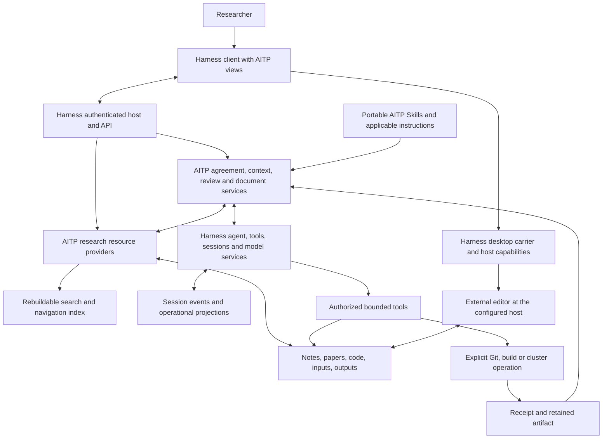
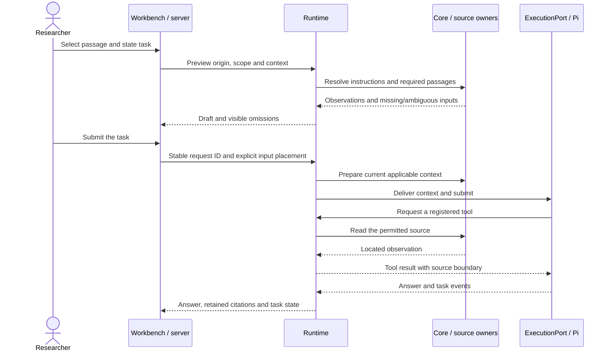
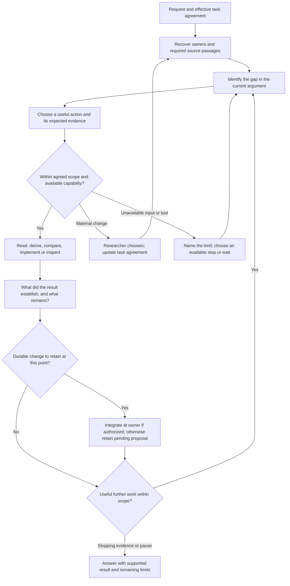
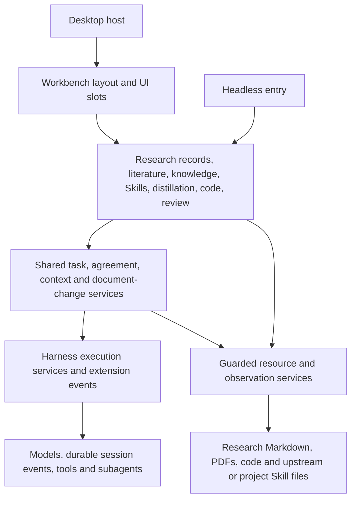

# 10. Target architecture: a project-centred research IDE

Living architecture, updated 2026-10-22. This is the canonical explanation of how the completed aitp-agent should work: its capabilities, component cooperation, data ownership and boundaries. The researcher selected the official DeepSeek Harness source as the application base, preserving the scientific design and authorizing the fork integration, naming and GPT adaptation. [14 Development plan](14-implementation-blueprint.md) owns the bounded implementation scope, progress and sequencing; [13 Research cases](13-research-journeys.md) owns case-by-case suitability and coverage. The retained Pi implementation under `agent/` and its [integration evidence](../../agent/notes/integration.md) are historical reference, not the active Harness runtime. Research workflows still require implementation and acceptance on the new host.

The product is a place to return to a scientific question, inspect what supports the current answer, and carry out the next authorized piece of work. A project opens on its research state. Papers, knowledge, notes and code have independently usable workspaces. A conversation is work on a selected object and can sit beside its material; it is never the prerequisite for finding that material.

The user-facing model has three proposed entrances: **Research**, **Materials** and
**Collaboration rules**. Research shows the current question and work; Materials finds
sources and methods; Collaboration rules lets the researcher inspect and edit how the
agent should work. The [interface](12-desktop-interface.md#progressive-disclosure) hides
implementation detail while retaining consequential conditions and choices. Internally,
[plugins](#plugin-composition) supply capabilities, shared services coordinate them and
Harness executes model/tool work. These internal parts do not each require a navigation page.

**Confirmed requirement, 2026-10-22:** the researcher requires modularity so core parts
can be optimized and upgraded independently. UI-editable collaboration rules and selective
information display are also requested capabilities. These requirements are settled;
Harness/Cordis is now the selected plugin framework; exact research-service interfaces and each research implementation slice remain to be specified within the scope in 14.

## Design package and evidence

| Document | Responsibility |
| --- | --- |
| [11 Research memory](11-research-memory.md) | Object ownership, format alternatives, trial limits, identities and migration |
| [12 Desktop interface](12-desktop-interface.md) | Screens, transitions, layout alternatives, components and visual acceptance |
| [13 Research cases](13-research-journeys.md) | Concrete scientific situations, required cooperation, implementation coverage and suitability checks |
| [14 Development plan](14-implementation-blueprint.md) | Current progress, next scope, dependencies, evidence and implementation gates |
| [Isolated prototype](prototype/README.md) | Synthetic interaction demonstration, run instructions and tested limits |
| [15 Design review](15-design-review.md) | Astra critique, disposition and remaining decisions |

Evidence categories used throughout: **observed** means inspected code or retained experiment; **recorded** means a prior result whose original run was not repeated here; **inference** is an architectural judgment; **proposal** requires design approval; **open** is a decision or evidence gap. Public examples are synthetic. The real-note examples and trial outputs remain in the established private design/build record.

## What AITP-agent should add

The additional value is a research workspace that consistently connects scientific state to the work that produced it. A model can help derive an equation, read a paper or modify code in either host. Codex already supports project/file context, persistent chats and reusable Skills; these are not unique AITP-agent capabilities. The official [project documentation](https://learn.chatgpt.com/docs/projects) and [Skill documentation](https://learn.chatgpt.com/docs/build-skills), checked on 2026-10-21, establish that baseline. AITP's existing Markdown Skills can also guide those hosts.

The product hypothesis is that dedicated research objects, views and coordination reduce repeated context reconstruction, lost qualifications and manual linking across work. It does not establish stronger physics reasoning from the same model. Each proposed benefit must survive a concrete case and comparison with the researcher's existing Codex/Claude Code workflow, including the AITP Skills they already use.

| Added research capability | Concrete benefit to demonstrate | Cooperating parts and cases |
| --- | --- | --- |
| Return to the scientific frontier | Find what is established, why a thread is waiting and what remains authorized without reading several chats | Source projections + project/thread views + session/task context; [C01](13-research-journeys.md#c01), [C02](13-research-journeys.md#c02) |
| Follow an argument to its support | Open the exact argument/paper edition/code range used, retain its assumptions and distinguish it from today's changed source | Resource references + retained observations + reader/citation UI; [C04](13-research-journeys.md#c04), [C06](13-research-journeys.md#c06), [C07](13-research-journeys.md#c07) |
| Connect formulas, implementations and observations | Inspect a formula, actual checkout, calculation inputs and diagnostics together; identify the missing validation | Code/works/run adapters + source-aware editors + bounded tools; [C08](13-research-journeys.md#c08)–[C11](13-research-journeys.md#c11) |
| Track computational coverage and physical acceptance separately | Know which points ran, which checks passed, which comparisons are valid and which scientific claim remains unsupported | Receipts + coverage adapters + explicit acceptance passages + qualified outcome; [C09](13-research-journeys.md#c09), [C10](13-research-journeys.md#c10) |
| Preserve a reading and learning trajectory | Keep exact edition/page, prerequisites, unresolved derivation steps and researcher feedback across discussions | Library + reading notes + knowledge + learning Skill; [C03](13-research-journeys.md#c03)–[C05](13-research-journeys.md#c05) |
| Browse a knowledge wiki and literature library independently | Find a concept or paper, follow its prerequisites and sources, and return without creating a project or chat | Global resource indexes + knowledge/works adapters + shared readers and navigation; [C19](13-research-journeys.md#c19), [C21](13-research-journeys.md#c21) |
| Inspect and maintain existing knowledge | Review the exact support and missing conditions of a selected entry, retain unread boundaries and propose a scoped correction | Knowledge/source comparison + review coverage + existing proposal/application flow; [C20](13-research-journeys.md#c20) |
| Make research review actionable | Give an independent reviewer the relevant source/log, retain objections and assess which proposed passages actually change | Review execution + proposal revisions + author assessment + controlled application; [C12](13-research-journeys.md#c12), [C15](13-research-journeys.md#c15) |
| Reuse research without duplicating its conclusions | Locate a reusable result or demonstrated method, preserve its conditions, and update affected uses when it changes | Knowledge/where-used views + source owners + distillation/review; [C13](13-research-journeys.md#c13), [C14](13-research-journeys.md#c14) |
| Continue across sessions and tools | Keep the scientific owner and task boundaries through interruption, delegation and external editing | Runtime recovery + exports + host adapters + ordinary files; [C16](13-research-journeys.md#c16)–[C18](13-research-journeys.md#c18) |

A feature earns its place when a researcher can complete one of these cases with fewer wrong destinations, repeated explanations or lost conditions. Faster generation, a successful job, more agents or a polished dashboard does not by itself demonstrate that benefit. [13](13-research-journeys.md) records failures and remaining gaps so the architecture can be revised when a case does not fit.

### How this architecture governs development

Before changing behavior, identify the affected boundary here, the authorized slice in 14 and the case in 13. Preserve the accepted boundary during implementation. If a change needs a different contract, explain and revise that decision before dependent work; do not silently use documentation edits to ratify an unauthorized expansion. Routine corrections inside the agreed slice proceed normally.

Update the affected architecture passages, progress state and case coverage **in the same working change**, before handing it off or calling it complete. Unchanged documents need no ceremonial edit. Exact API payloads belong in protocol schemas and service contracts, detailed test receipts in implementation notes; link them here rather than copy them. The repository instruction is [AGENTS.md](../../AGENTS.md). Earlier 01–09 remain useful implementation/design references, but this architecture and 14 own the current target and sequence; neither an old document nor a proposed type changes the currently implemented API.

### What the retained Pi foundation establishes

The following observations concern `agent/` only. The Harness tree under `packages/` and `apps/` has its own model, session, tool, plugin, Web and desktop implementations; their existence does not transfer the Pi pilot's AITP research coverage. The [host mapping](#harness-service-mapping) identifies what to reuse and what remains to implement.

Observed: `agent/packages/core/src/notes/index.ts`, `locations/index.ts`, `paths/index.ts` and `index/index.ts` implement bounded source reading, discovery and search. `runtime/src/sessions`, `context`, `cards` and `compaction` plus `pi-adapter/src/port.ts` implement the session/context seam. The server and small React UI connect them. `protocol/src/sessions.ts` already distinguishes task, interjection and continue, and steer versus follow-up. The proposal preserves these distinctions.

Observed: documents, action authority, research adapters and worker execution are largely placeholders. `runtime/src/review/index.ts` exports a session and queues a request; that is not an executed independent review. `App.tsx` currently navigates home/board/settings/group/topic/note; it has no first-class thread, resource editor group or project work-session model. Moving the same dock to another side cannot supply those objects.

Recorded: the live read-only pilot, restart and compaction tests are in the integration record. Exact historical and standalone packaging test receipts have separate scopes linked from 14. The former 40-main-note threshold was derived from an inconsistent inventory. Replace it in a future approved test change with explicit expected/missing/excluded locations, rather than lower a number to manufacture success. These implementation checks remain useful; they do not decide product suitability.

Observed limits matter to the target flows: the CLI permits only the read-only profile, while full startup reaches unimplemented document recovery and action scanning. Session creation still requires a recognized research location; Global origins are proposed. Current context heuristics neither guarantee full-account delivery for restructuring nor block completion when a critical premise is omitted. The actual reviewer exports a session and queues a request. No diagram below should be read as evidence that these missing services already work.

**Selected direction:** retain this implementation for reference and comparisons while developing the active application on Harness. Reuse research semantics and useful pure parsers only after checking their assumptions; do not run a second Pi task loop inside Harness. The Skills carry scientific judgment; neither a relational graph nor a UI state machine can decide that a theory is established.

## Transfer from the reference applications

References were inspected on 2026-10-21. These are sources for interaction choices, not proof that AITP already has the features.

| Source | Pattern observed | AITP decision |
| --- | --- | --- |
| [OpenAI projects and chats](https://learn.chatgpt.com/docs/projects) | Project organisation and associated conversations | Keep project navigation and conversation history distinct; open the scientific overview on entry |
| [OpenAI code review](https://learn.chatgpt.com/docs/code-review?surface=app) | Explicit unstaged/staged/commit/branch/last-turn scopes; line-specific review | Label repository scope and attribution. A workspace diff is not automatically the agent's work |
| [VS Code user interface](https://code.visualstudio.com/docs/editing/getting-started/userinterface) | Persistent explorer, editor groups, tabs and keyboard navigation | Resources and work sessions share an editor area; two panes can compare different kinds of evidence |
| [VS Code WSL](https://code.visualstudio.com/docs/remote/wsl) | UI and tools can run on different sides of the Windows/WSL boundary | File access and Git execute with the filesystem host; the renderer receives resource identities |
| [ZCode source](https://github.com/zai-org/ZCode), especially `DESIGN.md`, `docs/design/workspace-independent-panels.md`, `docs/workspace-entry-draft.md` and `packages/ui/src/app-shell/WorkspaceShellLayout.tsx` | Semantic UI tokens, independently resizable panels, workspace identity and restored layout separated from session creation | Use a shared shell and explicit host identity; opening a project must neither send a prompt nor create a formal session |

The inspected ZCode archive is an earlier downloaded snapshot of its main branch; it is not claimed to match today's HEAD. The transfer above uses its design and source, not a live ZCode usability trial. VS Code's extension ecosystem and ZCode's provider/runtime architecture are not copied. AITP retains its research policy while adapting execution to Harness services.

## How the completed system fits together

The application is now maintained in its own repository. The pinned `aitp/` submodule
links [AITP-Research-Protocol](https://github.com/bhjia-phys/AITP-Research-Protocol),
whose `plugins/aitp/` owns portable scientific Skills and reviewer guidance.
The retained Pi CLI can resolve that checkout separately from application assets. The new Harness research profile must explicitly connect the selected Skill roots through its Skill/instruction services; merely retaining the submodule does not enable them. The submodule does not supply the missing application reviewer, resource adapters or authoring services.

This is the target cooperation diagram. The current implementation covers a subset identified in 14 and each case in 13. It remains one local backend with a shared renderer, not a separate service for every box.



AITP service definitions specify research resources, agreements, observations and document operations; Harness defines the execution, session, host and client APIs. Research services contribute through those APIs, with model-visible inputs retained in session events. Harness supplies execution machinery; it does not decide scientific ownership or acceptance. Every affected tool passes through the effective research agreement and actual filesystem/process authority. Browser navigation and native IPC do not bypass them.

### Responsibilities and connections

| Component | Responsibility in the completed product | Connections and boundary |
| --- | --- | --- |
| Workbench plugins | Project state, threads, resource readers, shared editor groups, session view, context/proposal inspection | Contribute through Harness client APIs and slots; layout/drafts are not accepted scientific conclusions or credentials |
| Harness composition and host | Authenticate clients, expose APIs, deliver resources, compose plugins and manage lifecycle | Reuse supported profiles/bundles and host APIs; research policy is a plugin consumer, not a second server |
| AITP resource providers | Read and interpret source owners; resolve references; expose notes, library, knowledge, checkout, run and manuscript adapters | Use configured filesystem authority; return explicit missing/ambiguous/unsupported results; derived relations never prove a theorem |
| AITP coordination services | Actual user choices, prioritized research memory, observations, review/application support and pending outcomes | Combine actual decisions with sources; use logged events/projections; never delegate permission to retrieved text |
| Harness execution and model adapters | Agent loop, scoped tools, sessions, interruption, compaction and model providers | Extend documented events/services; credentials stay backend-owned; no duplicate Pi loop |
| AITP service definitions | Resource/locator types and research task, proposal, review and outcome semantics | Change providers, consumers, serialization and fixtures together; old Pi protocol types are design input, not Harness APIs |
| [AITP Skills](../../aitp/plugins/aitp/README.md) | Research methodology: read the whole affected argument, distinguish proof/control/interpretation, retain failed routes, choose what to record | Same source guidance remains usable in Codex/Claude Code; Skills guide scientific reasoning; memory services supply relevant information without turning every procedure into a hard check |
| Host and external tools | Native window actions; optional code editor; bounded scientific processes and later cluster adapters | Every operation names its actual host/root; renderer has no arbitrary shell bridge; local UI disconnect is not process cancellation |

Research-source interpretation remains independent of model transport. Cordis profiles/bundles compose service definitions, providers and consumers. Workbench plugins use host APIs instead of importing backend implementations. The desktop carrier remains optional for research services. The old [package boundaries](02-architecture.md#packages) and [contract guide](09-contracts.md) explain the retained Pi tree only; they do not prescribe the new package layout.

### Capability cooperation

The **project view** is a projection of the main note's question, qualified answer and Current work. Its thread links lead to the owning passage, related evidence and operational sessions. The **library** locates a work and a specific edition; its reader produces an edition-bound selection. The **knowledge view** finds explanations and conditions reusable across projects. These share references, but a source reading, a proposed idea and an accepted result remain different kinds of material.

Global **Knowledge** and **Library** are independent entry points. Their indexes read existing owners through Core; collection filters, cross-links, outlines and back/forward navigation use the shared resource resolver and editor state. The knowledge route can run from a subject to a concept, its prerequisites and the original derivation. The library route can run from a collection to a work, a particular edition and its source-ordered reading notes. Paper sections, equations and unresolved steps remain reachable; a wiki overview does not replace close reading. Unknown index coverage and unavailable files are explicit. Browsing does not create a session, mark material read or reorganize files.

A **knowledge review** starts from a selected passage or bounded collection, even when no edit has been proposed. Human inspection uses the same source comparison panes. A requested model review passes that scope and source observations to Runtime's independent reviewer; its findings identify what was actually inspected and which dependencies remain unread. A correction then uses the existing proposal, assessment and application flow. Bibliographic curation follows that flow for its named metadata owners. Search links and duplicate candidates are navigation aids, not judgments of scientific support or authority to merge records. P2 supplies reading surfaces; actual reviewer execution and writes retain the later gates in [14](14-implementation-blueprint.md).

The **code view** resolves the actual checkout, selected revision/diff and repository instructions. The **run view** connects inputs and execution receipts to retained outputs and the question they test. The **manuscript view** connects paragraphs, figures and citations to those owners. A figure is reachable through its data and generating procedure; an artifact receipt states what ran, while the scientific note explains what that observation supports. Missing provenance appears as a gap, never a green validity badge.

The **work-session view** brings these selections together under an explicit task. The **review and outcome flow** turns proposed changes into reviewable source edits or leaves a clearly named obstruction. The **method view** makes demonstrated procedures discoverable as Skills; it does not automatically install them or convert every successful conversation into a reusable method. All six resource activities remain useful without opening a conversation.

### Where information lives

| Information | Primary owner | What survives or changes |
| --- | --- | --- |
| Scientific questions, assumptions, arguments, outcomes and live continuations | Ordinary research notes and their supporting files | Remain usable without the application or its index; substantial changes are reviewed source edits |
| Paper content, reading notes and reusable knowledge | Existing library/knowledge owners with edition/source references | Reuse links to one owner; reading or attaching a file does not promote its claims |
| Code, calculation inputs, raw outputs and figures | Actual checkout and declared run/artifact locations | Preserve original material; Git history is optional and repository-specific |
| Conversations, tasks, delivered context, choices, proposal/review/action records | Backend operational storage through Pi/AITP state | Retain actual request and delivery observations across restart; losing the navigation index must not lose these records |
| Authoring baselines and retained output copies | Proposed observation/artifact stores | Opaque IDs; retain only what was actually captured. No content-hash check is reinstated |
| Search results, extracted project objects and where-used navigation | Rebuildable derived index | May be discarded and rebuilt; a stored edge is not independent scientific evidence |
| Open panes, scroll, filters and unsent drafts | Client view state | Restore presentation without submitting a task or granting permission |
| Configuration, root/host mappings and credentials | Backend configuration/credential stores | Mappings are explicit; secrets never enter scientific notes, prompts or renderer storage |

Current source and delivered observation are separate objects. Reading a file again does not retroactively change what an earlier answer used. A timestamp records observation time, not proof of identical content. References distinguish a path/anchor, an edition/page and a captured excerpt instead of pretending they are interchangeable.

### Three complete paths through the components

**Return and read.** Opening a project asks the server for a Core projection. Core resolves the source owner through guarded paths and returns source passages, locators and unresolved references. The UI renders those passages with their qualifications. Choosing a thread opens its owner and relevant sessions; nothing sends a model prompt. Selecting a paper or code range adds explicit source context only when the researcher chooses a work action. Case [C01](13-research-journeys.md#c01) can therefore fail on navigation or lost qualifiers before model quality enters the comparison.

**Ask a source-grounded question.** A draft carries origin, intent and selection. Runtime previews instructions, required material and omissions through Core. On submission it rechecks applicable context, records the request and delivered observations, and calls the execution port. A model tool request returns through runtime to the appropriate guarded adapter. The answer links to the observation used; the UI separately offers the current source. A missing critical premise is exposed in the context and answer; the agent can retrieve it, reason conditionally or choose another useful step, without claiming complete verification. The target sequence is:



**Investigate, review and update.** A numerical or code task begins with the scientific observable, scope and acceptance criteria, not with an unbounded shell request. Runtime admits only the authorized operation, records command/inputs/environment and exposes its actual receipt and output. An analysis may support a proposed conclusion, but runtime completion does not make it accepted. For an authorized substantive note revision, document services prepare the relevant change over the affected argument. When the actual task or selected authoring policy calls for independent review, a reviewer receives the relevant sources and log and the main agent assesses its findings; required researcher choices remain pending. Application follows the actual task scope and the separately selected non-hash authoring policy, writes through the document service, rereads the result and records any partial application. Core refreshes the affected projection, and the UI links the outcome back to the owner. A no-change or failed result can close the operational task while leaving the scientific question open. [C09](13-research-journeys.md#c09), [C10](13-research-journeys.md#c10) and [C15](13-research-journeys.md#c15) test different parts of this path.

### Coordination when something changes or fails

| Event | Required cooperation and visible result |
| --- | --- |
| A source changes outside AITP | Core rereads on use/refresh; UI distinguishes current content from retained observations. Later review/apply checks declared affected dependencies; no hash or silent auto-rebinding |
| A premise is absent or excluded by the context budget | Context service retains the exact omission; partial work stays labelled. A complete verification/restructure/apply claim waits for actual required reading |
| A task needs a consequential choice | Runtime persists the question and waiting state. An interjection can answer status without replacing the task or answering the choice |
| Client disconnects or a tab closes | Backend remains authoritative for execution; reconnect queries retained task/action state before offering a retry. Draft/layout recovery never submits again |
| Backend restarts after a possible external effect | Proposed full startup recovers local journals and reconciles uncertain effects before scheduling. Unknown remote outcome is not replayed as a fresh submission |
| A reviewer fails or omits relevant sources | Review coverage remains incomplete; a queued request or demo review label cannot open the application gate |
| A source moves, an anchor is duplicated or a host is unavailable | Resolver reports unresolved/ambiguous/unavailable with the original reference; recovery requires an explicit mapping or selection, not a title guess |
| Evidence overturns an earlier conclusion | Find source-backed uses, propose corrections at the owning claim and affected uses, preserve the failed route. Relations help find candidates; the researcher/agent still assesses their scientific consequence |

These are target guarantees with tests in 14 and cases in 13. In particular, current `whereUsed` discovers links in known main notes, not a complete semantic dependency graph; current context preparation uses English intent heuristics and explicit scoped files, not a proven whole-argument readiness check. Test meaningful Chinese and English tasks against the same source requirement. No component can automatically certify a proof, thermodynamic limit or physical interpretation merely by transitioning a task to complete.

## The object model

Three kinds of record have different owners:

1. **Scientific record:** ordinary files hold questions, arguments, evidence, qualified answers, decisions and continuations. AITP, Codex, Claude Code and the researcher read the same owners.
2. **Operational record:** the runtime owns conversations, active tasks, delivered context, actions, proposals, review reports and outcomes. An outcome links to science; an assistant message does not itself update scientific state.
3. **Disposable projections:** parsed objects, search, where-used links, previews and navigation are rebuildable. Losing this index loses convenience, never an accepted result.

| Concept | Meaning and owner | What it is not |
| --- | --- | --- |
| Project | Durable workspace initially associated with a top-level topic folder; its home is an existing main note or family README | A session or automatically generated summary |
| Direction | A question or programme grouping, expressed in source links | A mandatory extra directory level |
| Subproject/branch | A question with its own argument and main note; may have several scientific parents | Every subdirectory |
| Thread | A continuation owned once by a Current work entry | The latest chat or scheduled job |
| Open question | An unresolved scientific issue anchored in the argument | A to-do that must immediately be assigned |
| Idea | An uncommitted seed; discussion can end without promotion | Authorization to create a branch |
| Decision | Scope, choice and rationale at the passage whose meaning it changes | A permanent grant to execute |
| Evidence | A derivation, located source, report, receipt or result with stated limits | Automatically supporting every linked claim |
| Knowledge entry | A reusable explanation/result in the shared collection, with support/review labels | A duplicate project conclusion |
| Work session | Runtime conversation started from an origin and intent, carrying an authorized task | A replacement for the owning scientific note |
| Activity | A dated read, run, change or commit | Scientific progress measured by volume |

Relationships follow the canonical vocabulary and source rules in [11 §3](11-research-memory.md#3-objects-and-relationships). An ordinary link initially means only `links-to`. Stronger relations require an explicit source statement; a proposed scientific relationship is integrated into its source before appearing as accepted. Cross-project membership uses references to the same object. No content is copied to populate another project.

### Identities and discovery

Use the existing `ResourceRef`/locator idea, extended as described in 11. An identity includes the filesystem authority and configured root, then relative path and optional explicit anchor. A stable human-readable anchor survives heading renames; path fallback keeps old notes usable. No hash-derived identity or content certification is introduced. A move without a recorded alias yields an unresolved reference, never a guessed replacement. Duplicate anchors produce a diagnostic and require disambiguation before edits.

Projects may be note-backed, family-map-backed or learning-story-backed. A family README does not acquire a fictitious umbrella hypothesis. An unattached paper or code checkout is browsable globally; starting work there uses a global research context, not a fabricated topic. Scope is supplied by applicable instructions and the actual request.

Discovery follows configured roots, root/README links and explicitly attached paths. It excludes snapshots and output forests by policy and reports exclusions. A bounded Unmapped list exposes relevant note candidates without silently promoting them. Global search uses notes/library maps/selected checkouts, never an unbounded crawl of run data.

## One interface, three entrances and independently navigable resources

The default entrances are Research, Materials and Collaboration rules, with global Search
and ordinary Settings. Research contains projects, branches and work sessions; Materials
contains literature, knowledge, notes, code and method Skills. Resource types remain
independently browsable and pinnable without becoming compulsory top-level pages.
Collaboration rules displays editable source guidance and the effective task rules through
the [shared rule projection](#editable-rules). Project selection supplies an optional filter,
not a prerequisite. Switching entrances retains open editors and does not mutate task scope.
The header shows the current project or Global and host; the same paper edition can be
opened from different projects without being copied.

```text
Application shell
  ├─ project/resource explorer ── sourced objects and links
  ├─ editor groups ───────────── overview | thread | note | PDF | code | session
  ├─ optional inspector ──────── evidence | relations | history | context
  └─ optional activity panel ─── actions | runs | problems

Selected object → prepare work → visible task + source selection → durable session
                                  ↓
                    proposed outcome → review/authorized application → source owner
```

A project overview has the question, qualified current answer and decisive gap, then active threads and pending decisions. It displays source passages with their caveats. Long passages expand in place or open the owning note; a character cutoff may never turn a conditional result into an unqualified headline. Ideas and related subprojects follow, with activity in a secondary region. There is no completion percentage for a research project.

The useful difference from a note reader is testable: entering a thread locates its current owner, limiting evidence and relevant past work without explaining filenames to a model; the researcher can inspect a source and code side by side before starting a session; after a session, an explicit outcome links the changed argument to the actual artifacts. Merely adding colourful cards does not meet that test.

## Work-session and context architecture

The origin is a project, thread, idea, paper passage, note range, code selection/commit, run or knowledge entry. Intent is explore, learn, derive, verify, implement, review or write. Intent selects a context recipe and presentation, not new authority. A single concise composer shows the task draft, origin and optional material chips. Detailed context and scope are expandable; ordinary reads do not require a wizard.

| Intent | Mandatory context, beyond applicable instructions | Failure that must remain visible |
| --- | --- | --- |
| Status/continue | Owner opening and Current work; operative plan/choice; parent using passage when relevant | Missing owner or unanswered choice; Continue cannot silently pass it |
| Derive/verify | Exact selected argument, assumptions/conventions and cited premises; earlier failed route | An unresolved premise remains unresolved, including when a model sounds certain |
| Read/learn | Edition, selected passage and locator, paper map and requested prerequisites | Missing full text or ambiguous printed/PDF page |
| Implement/review | Actual checkout/branch, selected code/diff, scientific formula, repository instructions, relevant receipt | Dirty changes from other sources; no invented attribution |
| Write | Complete affected argument, proposed scope, citations and dependent passages | A partial excerpt is insufficient for restructuring |
| Explore | Seed and relevant local context, explicitly uncommitted task | No branch or note is created just by starting the chat |

Project/library context and session/task context are independent. Switching projects or tabs never mutates a running task or its granted roots. Adding a selected paper to a busy session creates a queued submission with that material, preserving `InputSubmission` placement semantics. Interjections retain `ActiveTask`; an explicit new task changes it. A new conversation inherits scientific context but not another conversation's execution grants.

Context assembly uses existing instruction/data separation, bounded budgets and the recorded manifest. Origins and recipes extend `SessionMeta`; global origins use the explicit `ContextHome` union below instead of faking a workspace path or relying on two independent optional fields. A draft can be abandoned without creating a runtime conversation. Once sent, `create/submit` receives a stable request ID; reconnect does not submit twice.

On resume, show the retained task and reread current sources. Recorded observations and current text remain distinguishable. The inspector can show what was delivered at a particular request, including omissions. Hash checks are disabled: observation time is not proof of unchanged content, and a current-file citation is not an immutable snapshot. Where exact prior text is retained, give it an opaque observation/snapshot ID and the captured excerpt. Historical Git references identify commits without treating them as authority for execution.

<a id="research-control"></a>
## Research decisions, constraints and the next useful action

**Researcher-selected default, 2026-10-21; clarified 2026-10-22:** the researcher and agent establish the objective and boundaries;
the agent autonomously chooses routine next actions within them. A material change to core assumptions,
algorithm or research direction returns to the researcher for discussion before dependent work. This choice
settles the default delegation policy, not approval to implement the application or start a new research
campaign. A task may explicitly narrow or broaden that delegation. A status question or a new UI selection
does not silently change it.

AITP prioritizes important research context and remembered choices; it does not prescribe an action whitelist, mandatory prerequisite gate or fixed research pipeline. The intended research loop is adaptive. It should help answer: *what is currently missing from the argument,
which action could remove that uncertainty, and would success actually advance the original question?*
An intent such as `derive` supplies useful initial context; it does not lock the session into one tool family.
A derivation may need a source check and a code comparison may reveal a missing analytic premise. Fluent work
continues without a planning ceremony after every tool call. Reconsider the next action when evidence,
an obstruction, an applicable constraint or the purpose of the task changes.



This is cooperation among research services within Harness's model turn, not a new autonomous supervisor service.
The language model, guided by relevant Skills, proposes the scientific gap and next action. Source providers resolve
and read the actual sources. Context records what was supplied and what is missing. The shared task/context projection preserves actual user instructions; existing host permissions govern execution. Review challenges consequential reasoning and source changes. Harness supplies
execution and persistence, not a scientific choice function. An unavailable capability produces a visible
limit; no route choice fabricates a successful lookup, run or review.

### Working state and the researcher's freedom

Carry the research semantics of the retained `ActiveTask` and context records in owned Harness events/projections, rather than add another scientific-state database:

| Task information | Owner and update rule |
| --- | --- |
| Objective and effective agreement | Existing task state, with references to the actual user request and subsequent choices; retain allowed actions/roots, binding exclusions, resource limits, delegated choices and stopping conditions when stated |
| Scientific setting and current supported answer | Source passages in the owning note; runtime carries references and observed excerpts, not a second editable answer |
| Present gap, candidate action and reason | Revisable model working state associated with the task; show the proposed next action and what it could establish when useful, without treating the suggestion as a user decision |
| Required inputs and coverage | Existing context manifest extended with operation-specific requirements and delivered observations; distinguish missing sources from optional background |
| Action outcomes and pending integration | Existing events, receipts, proposals and outcome references; a completed reply or tool call does not mean the research note changed |

A clear user choice updates the effective agreement once, preserving the parts it did not change. Associate
the update with its request/answer and an opaque revision, not a digest. Context, reviewer and any later
worker receive the same effective scope. Before a queued action executes, check the then-current scope;
an earlier queued suggestion cannot override a later restriction. An ambiguous consequential change pauses
only the dependent action. Routine source reads, derivations and implementation already authorized continue
without repeated permission. Operational agreement state is a projection of actual instructions, never a
grant synthesized from a paper, search result, historical success or model-generated plan.

Two independent questions determine freedom: **which actions are allowed**, and **which decisions have been
delegated**. An analytic-only task may allow broad analytic exploration while excluding numerical execution.
A tightly chosen numerical method may allow implementation and diagnostics while reserving solver changes
for discussion. An explicit comparison of candidate methods permits that comparison within its stated budget;
it does not automatically adopt a winner. A working hypothesis may be explored provisionally without being
promoted to the governing assumption or an established result. New independent investigations remain scope
choices. These distinctions should be inspectable and adjustable per task, not hidden in a permanent mode.

### Choose actions from the gap, not a prescribed sequence

The following are decision aids, not mandatory phases or an exhaustive physics classifier. Other actions
can be proposed with the same explanation of purpose, required evidence and scope. Prefer an informative,
proportionate step whose possible outcomes would change the judgment; do not invent numerical scores for
its expected information value.

| Present uncertainty | Useful next action | Return or reconsider when |
| --- | --- | --- |
| A definition, convention, existing result or failed route has not been recovered | Read the owning note and relevant personal-knowledge entry; use its index once and follow the needed sources | The needed premise is recovered, or local coverage is insufficient/contradictory; absence of a search hit is not absence of knowledge |
| An imported theorem, citation, edition, novelty claim or missing background is uncertain | Inspect the stored original source; search primary literature when the source or coverage is insufficient | The relevant scope or precise unresolved issue is known; do not expand into a survey that no longer serves the question |
| Definitions and premises are available but the decisive inference is missing | Derive it, examine a counterexample or a faithful special limit; use permitted computational checks only if they address the inference | A result or specific obstruction appears; failure of one ansatz is not failure of every possible argument |
| A formula disagrees with observed program behavior | Trace the actual code path, inputs, conventions and observable against the formula and retained output | The discrepancy is localized; repair the agreed implementation or discuss a consequential method change before adopting it |
| The intended method, inputs and discriminating validation are settled | Implement the bounded change and perform relevant checks | A check fails or an unresolved solver/truncation/acceptance choice changes the task; software success alone does not settle the physical claim |
| Work has consequential dependencies, multiple sessions, costly actions or competing routes | Make or update a concise plan in the existing owner, then execute its authorized parts | Evidence invalidates a premise or a required choice remains open; a one-step routine fix needs no separate plan document |
| A new, changed or disputed consequential claim is about to support a decision or main account | Perform a relevant independent check or scoped scientific review | Its actual support and limitation are known; model agreement and a review label are not proofs |
| Repeated steps no longer change the scientific judgment | Ask what perfect success would establish about the original question; inspect retained failures and alternatives | Select a discriminating step, retain a precise obstruction, or discuss a material route change rather than expand an uninformative scan |

Choosing literature versus derivation is normally the agent's job under the selected default. Choosing a
different physical model or a consequential solver is a researcher decision unless explicitly delegated.
Missing evidence should prompt investigation; missing intent may prompt a question. Do not ask the researcher
to vote on the truth of a theorem or use their choice as evidence that a physical interpretation is correct.

### Detect shortcomings at the inference where they matter

Scientific scrutiny uses relevant Skills and the actual argument. Introducing an imported result should
expose its hypotheses, conventions and source. Interchanging limits calls for its justification. Moving from
finite observations to a general statement calls for the missing extrapolation or theorem. Comparing code
with theory requires the executed map, boundary conditions and observable. A small residual, matching plot
or passed test may establish a narrow fact while leaving the physical selection or interpretation open.
These triggers guide a targeted check; they are not a checklist repeated for every ordinary response.

When a premise is missing or disputed, retain the exact claim, the needed evidence and which inference
depends on it. A discovered contradiction should first be checked for different versions, assumptions or
conventions. Review both sides; neither recency nor majority agreement chooses the scientific answer.
Stop investing in the affected inference when its prerequisite is invalid, while continuing independent
work within scope. Later correction updates the owning argument and actual dependent uses, as
[11](11-research-memory.md#memory-writeback) specifies.

| Responsibility | What the system can do | Limit |
| --- | --- | --- |
| User choices and host permissions | Preserve actual instructions and use existing tool/path permissions; expose conflicts that need the researcher's choice | No automatic scientific action whitelist; model interpretations cannot create new user decisions |
| Context awareness | Surface important assumptions and source gaps; keep pointer-only, omitted, unavailable and earlier observations distinct | Delivery does not prove comprehension or completeness, and missing material does not automatically stop research |
| Scientific scrutiny | Select relevant checks, surface counterevidence, retain qualifications and obtain independent review where warranted | It remains fallible scientific reasoning; no state transition can certify a proof or discover every physical defect |

The interface must accurately describe which material was supplied and which remains missing. It cannot mechanically prevent every unsupported sentence a model
generates. Source-fidelity and overclaiming therefore remain evaluated behaviors with human review, separate
from source-delivery and persistence checks. A partial context can support a bounded explanation or search for missing
material; it must not freeze the entire investigation or silently become a complete verification.

### Retained implementation evidence and migration boundary

The retained Pi [context service](../../agent/packages/runtime/src/context/index.ts) assembles candidates and
records delivery/omission, but its English rewrite heuristic suppresses excerpts without guaranteeing whole
argument reading, and its budget can demote a decisive premise. Current
[task reconstruction](../../agent/packages/runtime/src/sessions/index.ts) retains the latest task request;
[choice answers](../../agent/packages/runtime/src/cards/index.ts) persist as inputs, without a structured
effective-agreement revision. [Tool guards](../../agent/packages/runtime/src/compaction/index.ts) cover a
limited set of mode/tool exclusions. [Review](../../agent/packages/runtime/src/review/index.ts) queues and
exports; it does not run the reviewer. Action authority and document application remain placeholders.

Consequently this loop is a proposed refinement of the existing architecture, not an implemented research
controller or an empirically established improvement in scientific judgment. [14](14-implementation-blueprint.md)
places its read-only scope/context seams in P1, material retrieval in P2, review/writeback in P3–P4 and later
long-running/parallel execution in P5. The [cross-case exercises](13-research-journeys.md#adaptive-research-checks)
specify how evidence changes should alter behavior without demanding one exact tool sequence.

## Module boundaries and API evolution

Use Harness's service-definition/provider/consumer organization within one application. The old seven-package Pi layout is retained history, not a constraint on the new implementation. The concrete [host mapping](#harness-service-mapping) links available upstream services.

| Boundary | Proposed addition | Existing owner/reuse |
| --- | --- | --- |
| Research definitions | Resource/origin, sourced relations, observations, agreements and outcomes | AITP-owned service/event definitions; retained protocol is semantic input |
| Source providers | Project projection, anchors, bounded resources and where-used | Harness filesystem services; reusable parsers only after assumption checks |
| Coordination providers | Context selection/delivery, remembered choices, review/application support and outcomes | Harness request/tool/compaction events and session projections |
| Host API | Authenticated resolution, paged projections and binary access | Existing Harness host/API services |
| Client | Shared readers, research navigation, inspector and presentation state | Typed slots and supported client state/API contributions |
| Host capability | Open/reveal, desktop lifecycle and explicit resource host | Existing Harness carrier/capabilities, with actual WSL acceptance |
| Model/execution | Model transport, agent loop, sessions, tool dispatch and subagents | Existing Harness providers; no private UI imports or parallel execution loop |

Proposed research operations include project/object lookup, bounded relations, session-draft preview and resource resolution. Specify their Harness service/API names when implementing the selected slice. Preview is read-only and returns draft, instruction/data refs and omissions without creating a task. Actual submission uses the Harness input/request path. Reads retain observation time, locators and diagnostics; an unavailable provider never returns fabricated successful emptiness. Settle each shared interface before its concurrent consumers, without freezing every future interface first.

UI layout is local view state: editor groups, focus, project filters, scroll, draft and resource locators. It stores no scientific answer. Operational metadata has explicit compatibility and an export path; an unavailable index can be rebuilt. Old Pi sessions stay in the retained implementation/export; no automatic runtime-store migration is authorized.

<a id="independent-development-boundaries"></a>
### Independent development boundaries (proposal)

The researcher requested independently developable steps. The proposed
[workstreams and integration order](14-implementation-blueprint.md#independent-development)
separate module development from product acceptance milestones within the selected Harness application. A workstream owns behavior and files behind an agreed interface;
it does not require a new service, runtime, repository or copy of scientific memory.

Shared seams are resource/observation identity, effective task agreements and lifecycle,
proposal/review revisions and coverage, and pane/host callbacks. Each has a single schema owner.
Source adapters report actual observations and unresolved results. Context tracks delivery and
current availability; it cannot infer physical validity from either. Session state retains the
task agreement; a reader's selection or a review report cannot silently revise that authority.
The document service owns proposed/applied changes, review owns its findings and coverage, and
runtime authorization controls whether an effect may execute. Preserve those responsibilities
when assembling the route rather than copying their state into each reader or UI panel.

Notes/wiki, PDF and code readers can develop against the common resource/selection boundary in
parallel. Preserve actual narrow data dependencies where needed; bibliographic metadata lookup, for example, does not require completion of the wiki interface. The shell can
host a small real note view while richer adapters develop separately. The native host depends
on authenticated attachment and host identity; it supplies no extra research authority.

Task/context correctness and actual Markdown proposal/review can be integrated without the
full resource UI or native host. An existing-entry reviewer does not require an edit proposal.
Controlled apply does require the real proposal, applicable agreement and assessed review,
plus the selected concurrency/recovery policy. Independent component tests can substitute
dependencies; a working scientific/user route must replace those substitutes with real services.
This is a development-boundary proposal, not a claim that new research providers already exist or that the old S1–S6 ownership map allocates Harness edits. Implementation and stage scope
remain owned by 14 and the researcher's actual instructions.

<a id="editable-rules"></a>
### Editable collaboration rules and actual adoption (proposal)

The researcher requires writing, memory and collaboration guidance to be editable through
the UI. Reuse instruction resolution, task agreements and context delivery; do not create
an independent rule database or a second rule engine for each plugin. The logical route is:

```text
Authored defaults + scoped user changes + current task decisions
       → resolve applicable sources, explicit replacements and conflicts
       → effective guidance and user choices → context preparation
                    ↘ same projection and actual adoption receipt → UI
```

Upstream Skills remain the default method source. Customization can replace or qualify
their guidance for an explicitly chosen personal, project or task scope. Edit an existing
user-owned instruction or agreement passage when it already owns that rule; otherwise use
an explicitly configured user-owned source. Task-only changes stay in the operational
agreement unless deliberately retained for future work. Show the actual destination and
lifetime before saving; a task correction does not silently become a standing preference.
Editing shared AITP guidance is a distinct upstream change. Ordinary customization never
edits the pinned submodule or copies the whole upstream Skill into an application prompt.

Common preferences such as language, audience and derivation depth can have controls only
when they map faithfully to their authored source. Prose and controls edit the same content;
unrecognized or complex rules remain editable as text. AI may suggest clearer wording with
a visible diff, but cannot silently paraphrase the researcher's operative instruction.
The effective projection retains exact source text, scope, provenance and opaque revision,
including any explicit replacement. Scientific links between notes do not imply instruction
inheritance. User-specified exceptions can replace defaults; unresolved conflicts are not
settled by concatenation order or by selecting a more permissive rule. Detectable conflicts
are shown with their source so the agent can resolve ordinary cases or ask about a consequential ambiguity. Natural-language conflict detection is
fallible and must not be advertised as complete.

Distinguish a draft, a saved source revision and the rules actually used by a model request
or action. Preference edits are adopted at the next relevant request boundary according to
the displayed scope. A restriction explicitly applied to the current task updates its
agreement before subsequent affected actions; already dispatched work keeps its actual
history and visible cancellation/unknown-effect state. Do not silently kill existing work
or claim a sent request has changed. Widening scope or changing a reserved method requires
the user's explicit instruction; an Apply-to-this-task action can supply it without a
second approval ceremony. Saving prose does not itself install a tool, grant filesystem
authority or implement a requested runtime check.

The UI primarily edits guidance and remembered choices. It distinguishes these from existing host permissions where relevant, without presenting every writing preference as a program-enforced control.
Historical requests retain their actual rule text; reverting creates a new revision.
Source edits outside the UI and relevant upstream changes are reread and exposed as changes
or conflicts without silently discarding local customizations. Existing non-hash authoring
and preservation boundaries apply to source editing.

In the retained Pi implementation, `Config.researcher`, `InstructionSource`, fixed Skill sections and `read_skill` supply
parts of the read path. There is no effective-rule resolver, rule editor or adoption receipt.
The declared `putConfig` API has no server handler, so editable rules need backend work as
well as controls. The [memory projection](11-research-memory.md#memory-user-view) and
[rule editor](12-desktop-interface.md#collaboration-rule-editor) describe the user experience;
14 owns the separately selected implementation scope.

<a id="plugin-composition"></a>
### Research plugins over shared services

The researcher subsequently asked for durable functional areas, including literature,
knowledge, Skills, distillation and replaceable UI, rather than only independent tasks.
The ten development lines above organize work; they are not the final plugin taxonomy.
The selected application base is DeepSeek Harness and its Cordis composition host. Shared research services, domain plugins and presentation/host adapters retain the responsibilities below. This is an authorized host change, not evidence that AITP's research plugins have been implemented.



The imported Harness source is version `0.2.1-rc.2`; exact Git ancestry belongs in the repository and integration evidence. Its [architecture](../architecture.md) separates service definitions, providers and consumers, composes profiles/bundles and disposes registrations with plugin lifetimes. Its [typed UI slots](../subsystems/slots.md) let features contribute views without importing one another's components. Its Electron desktop carries the Web plugin system. Ordinary host plugins share a process: lifecycle management is not security isolation. Start with first-party plugins and supported profile composition; arbitrary hot replacement is not an AITP acceptance prerequisite.

The retained Pi tree pins `pi-ai` and `pi-durable` to 1.3.0 and uses [static runtime registration](../../agent/packages/runtime/src/registry.ts). It remains a reference for research semantics and earlier failures. Harness may use its own `llm-pi-ai` model adapter; that adapter does not import the retained `pi-durable` conversation state or restore the old execution loop.

<a id="aitp-runtime-integration"></a>
#### Runtime research memory and contextual guidance

**Researcher-selected direction, 2026-10-22:** AITP belongs in the underlying runtime, principally by making important research memory available to the AI at the right time. The researcher explicitly rejected a fixed research-action constraint system. The runtime organizes, retrieves, delivers and refreshes context; the model chooses useful research actions from that evidence. Loading portable Skills is one part of this system, and does not implement memory selection, observation tracking or recovery.

There is one Harness execution loop. Cordis services/plugins provide shared memory and context functions to it, and domain plugins supply sources and views. These functions operate for terminal, Web and desktop sessions without a reminder to invoke a Skill. An AITP preset composes these plugins and their configurable source/priority defaults; the plugins implement the behavior, while the preset selects them. It is not a new agent loop or a fixed research mode. Existing host permissions and the researcher's explicit instructions still apply. AITP does not add a general rule that an unread premise prohibits reasoning, a literature search must precede derivation, a plan must precede coding, or a review must precede every ordinary update.

| Runtime module | Responsibility and interaction | What remains flexible |
| --- | --- | --- |
| Research-memory access | Resolve ordinary main notes, linked detail, knowledge, papers, code and Skill sources; return observed passages, locators and missing-source information through shared readers | Existing notes remain the scientific owners; no forced schema migration or second editable truth store |
| Context selection and delivery | Combine the current question, actual user choices, relevant hypotheses/conventions, supported results, failed routes and unresolved gaps; budget and deliver them through Harness context providers | Priority adapts to the current inference and user selection. The model can request another source or change focus; the default ranking is configurable |
| Working-memory continuity | Retain the actual task, important corrections, sources, useful intermediate reasoning and suggested next step; restore them after compaction/restart without treating a generated summary as a user decision | The next step is a revisable suggestion, not a fixed workflow state or an action whitelist |
| Evidence feedback | Observe source/tool results and identify context worth refreshing; distinguish observed, delivered, no-longer-available and unknown material | A gap is surfaced to the model and user. The agent decides whether to retrieve, derive conditionally, compare, ask or pursue another useful step |
| Memory maintenance and writing | Locate the correct main/subnote owner, prepare changes in scope, retain pending/no-change outcomes and reread written results; support review where the task calls for it | No compulsory planning/review ceremony for every action. Actual research writing remains outside the present implementation authorization; the later authoring policy is still unresolved |
| Collaboration projection | Let the user inspect and adjust source selections, remembered choices and writing guidance; show consequential omissions without exposing every runtime detail | UI uses the same memory/context state as headless work. A preference edit does not create an automatic research-action ban |

A useful default attention order is: the current request and explicit corrections; the scientific question and present frontier; assumptions, conventions and limitations needed for the current inference; relevant results and failed routes; selected source passages and applicable methods; optional background. This is an adjustable selection strategy, not an immutable ranking. A specifically selected source can become the most important evidence for the current question. Preserve the locator and reason for including material, and make omissions inspectable. Do not fill the context with every note or repeat the whole protocol on each turn.

For example, before an apparent thermodynamic-limit conclusion, surface the actual finite-size range and the note that extrapolation is unresolved. Before a code comparison, surface the observable and normalization convention. When a previously failed ansatz becomes relevant, surface why it failed and under which assumptions. These facts help the model notice a physical problem; the runtime does not decide the physical answer or prohibit exploring a conditional alternative.

The inspected Harness extension points support this design:

- Use asynchronous source/context preparation around [`agent/pre-step`](../../packages/core/agent/src/runtime-types.ts), then render prepared working-memory facts with [`systemPrompt.context`](../../packages/core/system-prompt/src/index.ts). [`AgentRuntime.step`](../../packages/core/agent-loop/src/agent.ts) refreshes registered context after provider preparation and logs it before the model request. A required context contribution means that selected runtime facts survive ordinary optional-context suppression; it is not a scientific-readiness gate.
- Use typed session events and [session projections](../../packages/session/session-projection/src/index.ts) for actual user choices, source observations, delivery information and pending outcomes. Model-visible content must remain reconstructable from the ordinary session log. [`appendPluginRecord`](../../packages/core/session/src/index.ts) is best-effort/ignorable and is unsuitable as the sole owner of facts whose recovery the application promises. An in-memory append and a successful disk flush are distinct; failure must be reported honestly.
- Reconcile retained observations with the context actually available after compaction. Rebuild the important task/choice projection and reread relevant scientific owners; do not assume that an earlier file attachment remains available because it appears in a UI manifest. The compaction provider can be adapted if a focused test shows that its current summary loses useful research reasoning. Avoid an additional autonomous supervisor loop.
- Model-invoked source reads feed the same observation/context service as initial selections. Adapters expose what they actually read and any missing locator or coverage. A model response, search snippet, full source and researcher decision remain different kinds of information.

The earlier inspection of tool-guard timing and filesystem intent-hook coverage is retained in the [integration evidence](../../agent/notes/harness-integration.md). Those findings describe the limits of a possible hard-enforcement claim; they do not make a new action-policy engine or final-dispatch patch a prerequisite for the selected memory/context work. An explicitly requested execution restriction can use the host's applicable mechanisms, with its actual coverage stated, rather than introducing permanent research modes.

The first demonstration should show better continuity and better-informed choices: one main note and linked source, a user correction, a relevant failed route, two compactions and restart, then a missing source. The AI should recover the important context, explain uncertainty and choose a useful next step without a forced planning card or fixed action order. Evaluate its visible reasoning and source use, not only a metadata flag. [14](14-implementation-blueprint.md#runtime-integration-plan) owns this proposed slice and its implementation status. No hash, version/conflict gate or approval digest is introduced.

<a id="harness-service-mapping"></a>
#### Mapping the research design onto Harness

| Research responsibility | Reused Harness machinery | AITP work still required |
| --- | --- | --- |
| Task choices and continuation | Agent lifecycle/inbox and durable [session events and projections](../subsystems/session.md) | Retain actual choices and corrections, distinguish them from generated suggestions, and restore important context for continued work |
| Sources and contextual evidence | [Filesystem services](../subsystems/filesystem.md), [context contributors](../../packages/context/README.md), system-prompt sections and compaction events | Research-root and locator semantics, important-premise reminders, configurable selection priority, actual observation/availability accounting and exact citations |
| Main notes, knowledge and literature | Filesystem/search capabilities, host APIs and client contributions | Main/subnote projections, source-backed knowledge, work/edition identity and readers; none is supplied by a generic file browser |
| Rules and methods | [Settings](../../packages/settings/settings/README.md), [Skill discovery](../../packages/skill/README.md), instruction contributors | One owned rule source, scoped overrides, saved versus adopted revisions, upstream/project Skill roots and evidence-based distillation |
| Independent review and writing | [Subagent services](../../packages/subagent/README.md), tools, sessions and persisted outcomes | Read-only reviewer composition, exact reviewed premises/proposal revision, assessment, pending integration and bounded apply/recovery |
| Workbench and native host | [Client](../../packages/client/README.md), typed slots, host APIs and [Electron carrier](../../apps/desktop/README.md) | Research/Materials/Collaboration entrances, shared readers, selective disclosure and actual Windows–WSL acceptance |
| GPT access | [Model services/adapters](../../packages/llm/README.md) and [credential services](../../packages/credentials/README.md) | Configure and test the selected GPT API or OAuth route, login consumer, streaming/tools/cancellation and model-specific compaction; report live evidence separately |

Use durable events for facts needed after restart and projections for their derived state. A model-visible agreement, premise or rule change must be reconstructable from the session log. Do not store a second transcript in an AITP service, assume a generic compaction summary preserves the agreement, or infer scientific authority from a plugin setting. Unsupported old Pi sessions remain readable through the retained implementation/export; automatic runtime-store migration is outside the selected scope.

| Area / candidate plugin | Owns | Shared services it consumes |
| --- | --- | --- |
| Research records | Markdown/main-note and family-map adapters, thread projections, parent/detail links, affected-use discovery and proposed argument edits | Guarded sources, observations, context, proposal/review/apply |
| Knowledge | Reusable explanations, conditions, source routes, wiki browsing and bounded search | Research-record/source interfaces; no separate editable scientific truth |
| Literature | Work/edition/file identity, PDF reading, locators, citations and optional retrieval adapters | Sources, observations, resource navigation; network/import effects separately scoped |
| Skill catalog | Discover configured upstream/project Skill files, inspect descriptions, resolve names and show actual source/version; load selected guidance | Guarded source reads and context instruction admission |
| Distillation | Invoke upstream `aitp-distill`, inspect motivating evidence and existing Skills, propose a focused Skill change and check a concrete use | Skill catalog, research records, model execution, review and document changes |
| Code | Checkout/files/diff/history and source-linked selections | Guarded read-only Git/source adapters; execution remains a separate capability |
| Review | Existing-entry or proposal review workflows, real reviewer execution, coverage, findings and author assessment | Agreement, actual observations, proposal revision and Harness subagent execution |
| Workbench presentation | Shared layout/navigation and slots for explorers, resource editors, inspectors, commands and result views | Typed resource and session APIs; feature plugins contribute optional client parts |
| Desktop host | Window lifecycle, authenticated backend attachment and explicit OS/editor capabilities | Same workbench/backend contracts; no independent scientific state |

Computation, scheduler and manuscript-build providers can be added in separately selected
slices. A domain plugin may have a backend and an optional client entry; its reading or
review service can run without the graphical shell. The shell chooses layout and navigation,
while the plugin owns its resource view. Both refer to the same resolved resource and actual
runtime state. The desktop carrier can be replaced without making the literature service
or research record depend on Electron. These are logical boundaries within this repository,
not a requirement for one process or repository per plugin.

Shared service contracts have distinct owners:

- **Task choices:** preserve actual requests, corrections and delegated decisions in working context. Source text and generated suggestions cannot impersonate a user instruction; existing host permissions retain their own owner.
- **Sources/observations:** resolve guarded resources, retain locators and actual reads,
  report unavailable material and distinguish historical observations from current files.
- **Context coordinator:** prioritize important research memory, budget candidate evidence, retain actual delivery/current-availability information and reconcile compaction. Gaps guide the next inference rather than imposing a fixed action sequence.
- **Document changes:** keep proposals/baselines, invoke applicable assessed review, apply
  only within the selected policy and recover partial work. Plugins propose edits through
  this service rather than each maintaining an independent writer.
- **Execution integration:** expose the selected Harness capabilities and actual available tools;
  plugin composition must not create a second competing agent loop.

Shared core services must be independently maintainable and replaceable behind their
contracts, as required by the researcher. This includes rule resolution, context selection,
source/note adaptation, document changes and the Harness execution integration. They must report unavailable memory/context accurately; optional source failures should leave useful work possible. A missing provider cannot fabricate a read or completed write, but is not itself a general prohibition on scientific reasoning.

For each selected module, state its responsibility, public inputs/outputs, owned data,
dependencies and focused acceptance examples. Consumers use that contract rather than
importing another module's private implementation. Keep dependency composition in the
composition host; pass explicit read-only views or lifecycle notifications where a cycle
would otherwise arise. This remains modular code in one repository/local application;
independent processes and arbitrary live swapping are not required.

An upgrade declares API/config compatibility and any persisted-record schema change.
Retained task decisions, source observations and outcomes cannot be silently reinterpreted
by a new implementation. Prefer compatible reads and explicit bounded migration; preserve
the previous data when an upgrade cannot resume it. A missing/incompatible provider is
reported for the affected operation. Default upgrades take effect at a safe task/request
boundary or restart, with the actual adopted version visible on demand. Future live
replacement must separately define in-flight work and rollback; installing a new provider
does not prove an old task has adopted it. No content-hash gate is introduced.

A discriminating modularity check is replacing the context-policy provider while keeping
the note and literature consumers unchanged, then reopening a retained session and checking
its agreement and actual evidence coverage. A UI-only change should need no research-record
migration. These are proposed compatibility checks, not completed implementation evidence.

A minimal plugin declaration needs its identity/API compatibility, provided/required
services, optional dependencies, configuration and namespaced contributions. Begin with
source readers/search, context candidates, tools/commands and UI slots, adding other kinds
only for an actual use. Data providers contribute sourced candidates and prerequisites;
the coordinator decides admission. Tool names cannot silently shadow another provider,
and existing Harness permissions still apply. AITP does not add a general scientific-action approval layer.
Missing optional providers disable the affected operation with an explanation while
independent work remains available. A missing required substrate can prevent that profile
from starting; it must not be silently replaced by a permissive fallback.
Start with trusted first-party plugins and startup composition. Enabling,
upgrading or disabling a plugin during an active operation needs explicit lifecycle rules:
stop new work, settle/cancel affected tasks, remove listeners/tools/views, and retain
readable outcomes. Shared-process plugins are not a sandbox for untrusted code.

The Skill catalog and distillation workflow have different jobs. The existing portable
`aitp-memory`, `aitp-writing`, `aitp-verify` and `aitp-distill` remain the methodology owners
upstream; application plugins provide execution, sources and views without copying those
rules. Core Skill descriptions and `read_skill` work in the retained Pi tree; its general method discovery and method-use services are placeholders. The Harness launcher now wires the pinned AITP Skill source; runtime research integration and its acceptance remain separate work. A reusable physics explanation stays in
notes/knowledge; an evidenced transferable operation can become a Skill. Drafting,
testing, local use, installation and publication remain distinct actions under the actual
task scope. No mandatory method-card database or central scientific registry is added.

First demonstrate the boundary with a minimal research-record provider and one literature
or knowledge provider, using the same resource/context interfaces with and without the
workbench. Relevant failures are a missing optional provider, ambiguous source, duplicate
tool name and a provider unavailable to a resumed task. These are proposed examples for
the next chosen implementation slice, not checks performed by this design discussion.

### P1 contract decisions: origins, authority and citations

The following records the research fields originally proposed for Pi version 2, not a Harness Session declaration or an instruction to edit the retained protocol. Bind equivalent fields to owned Harness events/projections when the P1 service slice is specified:

```text
ContextHome = { kind: note, resource: ResourceRef }
            | { kind: global, workspaceId: configured workspace identity }
WorkOrigin  = { kind: project|thread|idea|paper|knowledge|note|code|commit|run,
                resource: ResourceRef, selection?: Locator }
SessionV2   = { version: 2, contextHome, origin, displayProjectId?: ProjectRef,
                ...existing session fields except required location }
FileAddressV2 = { hostId, rootId, relativePath }
```

`FileAddressV2` is shorthand for a new file-address variant inside the existing `ResourceRef`, not a parallel reference type. `ResourceRef` remains the sole owner of locators, editions and resolution; adapters do not invent another locator normalizer. Host/root IDs are opaque configuration identities, not hashes or paths. A configured path may change without changing its root identity only through explicit mapping repair. P1 has one authoritative WSL/local host; multi-host attachment is a later named capability. Absolute paths remain server-resolved compatibility inputs. No identity inferred from a Windows path can silently target a WSL root. Two roots with the same relative filename remain distinct.

Retain legacy `location` sessions in the old Pi profile or an explicit read-only export; do not import or rewrite them as Harness sessions during this migration. A future importer must preserve their original configured root and report unsupported state. New global work uses the actual workspace instructions plus the requested resource's applicable instructions and scope, with no fabricated `research.md`. Backend services resolve applicability; the UI's project filter and `displayProjectId` cannot grant authority. A selected code checkout adds its repository instructions for work there. Attaching a paper adds data, not permission or instruction authority.

Scope comes from the actual user task and applicable authored instructions: configured workspace/physical containment, the task's owning note and operative agreement, and explicit constraints that govern the selected operation. Scientific parent and `links-to` edges are not an instruction inheritance graph. Read a parent's using passage for scientific context without automatically importing unrelated sibling restrictions or grants. When several applicable constraints conflict, retain them visibly and pause the affected operation for clarification; continue independent read-only inspection where allowed. Do not silently select the permissive parent or let a mode label override analytic-only scope. New task authority and material scope changes require the actual researcher's request. Resume rereads applicable instructions and reports a material conflict before execution; stored historical permission alone is insufficient.

Before sending, source preparation returns the proposed context and omission list. Read-only draft preview creates no session or authority; final admission at the Harness request boundary records what was actually sent, including changes since preview. The old Pi `ContextService.prepare(session,input)` explains the placement-time requirement but is not the new API. Specify preview and admission separately rather than changing semantics under one method name.

Global instruction resolution must explicitly load applicable workspace policy without depending on an owning note; the old Pi resolver's location-guarded branch was insufficient. Resource/repository instructions are added from the resolved target, not from the last selected sidebar project. Test a global library session while an unrelated analytic-only project is selected, and a code-origin task with relevant repository constraints.

Context selection distinguishes important premises from optional background and reports missing or omitted material. A pointer substituted for unread argument is not successful delivery. The agent uses these facts to choose retrieval, conditional reasoning or another useful step; incomplete coverage must not be labelled source-complete verification. Writing follows its actual task and separately selected policy, not an automatic readiness flag. Large accounts can be read in coherent stages with recorded observations and unresolved dependencies; listing their references alone does not count. Test token-budget omission of a decisive premise and confirm the UI retains the omission and the result cannot be presented as complete verification or an apply-ready rewrite.

P1 citations use existing retained delivered data and session entry/block IDs. A citation carries its current `ResourceRef` and, when available, a delivered observation locator (session, entry/block, excerpt range and observed time). Opening an answer citation defaults to that exact retained excerpt with “As used in this answer”; Open current source is a separate action. A full-file historical view is offered only if that file was actually captured. If old context is unavailable, state that explicitly and offer the current source without claiming it is identical. P3's opaque snapshot storage extends this capability for authoring baselines; P1 citation fidelity cannot wait until P3.

The Markdown navigation boundary must change in P1 even when the rendering pipeline is reused. Recognized safe anchor nodes are mapped to pane-local targets; arbitrary source HTML stays disabled. `openResource(ref, locator, group)` preserves cross-file fragments. DOM IDs include group/pane identity, so two views of the same note never scroll each other through global `getElementById`. Unresolved anchors open the source with a diagnostic. Acceptance includes two panes of the same note, cross-note durable anchors, and a scratch-source edit after delivery whose old citation still opens the delivered excerpt.

## Windows, WSL and the desktop host

Reuse Harness's existing Web and Electron applications. The [upstream desktop design](../architecture.md#desktop-application) owns packaged assets, local Host startup, authenticated transport and shutdown. Do not build another native wrapper or transplant the old Pi server's cookie/bootstrap flow. AITP research views should run through the same client plugins in Web and desktop; this reuse does not establish Windows–WSL research-root attachment or native usability acceptance.

The backend owns canonical POSIX paths and runs Git in the checkout's environment. A host-qualified root map distinguishes Windows, a specific WSL distro and future SSH hosts. Never equate `C:\\...`, `/mnt/c/...` and `\\\\wsl.localhost\\...` by string replacement. The desktop bridge resolves an explicit configured mapping and passes structured argument arrays to allowed operations. Symlinks and path traversal are checked at the filesystem authority. Unknown/missing mappings open a clear unavailable state.

Renderer Node integration stays off. Credentials stay in the runtime credential store, not browser storage or deep links. Native IPC exposes only open/reveal/window actions after validating the resource; it is not a shell executor. Opening VS Code delegates its editing/debugging UI while AITP keeps the research context and rereads actual files on return. Native AITP code support starts with source, symbols, search, diff and history; full debugger/LSP/extension-marketplace parity is out of scope.

**P2d adaptation:** select and test a supported Harness attachment route for the research filesystem host. Distinguish desktop-owned local processes from an independently running WSL/remote host; document who starts, authenticates, stops and reconnects each one. The earlier attach-only Pi proposal is historical and is not a claim about Harness Electron shutdown. A missing host reports the selected profile and unavailable capability without creating a substitute workspace. A renderer-provided arbitrary startup command is never an attachment mechanism.

Use Harness's existing authentication and native bridge restrictions. Research HTML/PDF and external navigation receive no application bridge. Test Windows–WSL reachability, distro/root identity, credential handling and close/reopen behavior on the actual host. Linux browser tests do not establish those facts. The product must state whether work survives window closure or is being stopped by the selected host; neither outcome is inferred from a closed UI alone. Automatic WSL discovery/start remains a separately bounded capability.

Disconnect preserves cached views labelled as observations, unsent drafts and task identity. It does not claim to abort a remote process. Reconnection queries task/action state before offering Retry; uncertain external effects require reconciliation. Closing a tab affects presentation only. Closing the app must expose any running work and whether its backend remains alive.

## History, writing and review

Local Git history is optional and requires separate approval of root, exclusions and checkpoint policy. No repository is initialized here. Notes, existing code repos and runtime stores remain independent. A note revision is associated with its exact change set and note commit if available; code commits retain their own repository identity. Runs retain receipts. Timeline joins are explicit links, not inferred from adjacent timestamps. Before note history exists, the UI says history is unavailable before the first retained observation.

Recommended authoring sequence: preview the affected source and dependent uses; independent read-only process review of substantial restructuring; main agent disposition; authorization within the actual task; apply through the document service; read back and record outcome. A reviewer must execute before accepting real authoring, not be postponed to advanced multi-agent work. Routine authorized small edits should not acquire redundant permission dialogs.

No hash/version/conflict/approval-digest checks are restored. Future exact anchored-text matching, current-source rereads, immutable proposal records and direct approved-argument equality are proposed alternatives, requiring approval with P3. They offer weaker guarantees than excluding arbitrary external writers; they cannot promise zero filesystem races or transactional multi-file writes. Ambiguity stops application and preserves the proposal. Recovery and rollback are new inspectable changes, never reset/restore over unrelated edits.

## Alternatives and decisions

| Choice | Alternatives | Recommendation and cost |
| --- | --- | --- |
| Research state | Database authority; YAML sidecar; stricter readable Markdown; distributed account | Recommend F2-style readable conventions with optional anchors and selective supporting notes, from 11's qualified assessment; preserve old formats |
| Main layout | Permanent chat dock; fixed workflow dashboards; shared resource/session tabs | Shared editors with optional inspector. Costs an explicit tab/focus model but permits work without chat |
| Scientific graph | Mandatory graph canvas; implicit prose only; typed sourced relations | Lists/where-used first, local graph only on demand; no inferred support edges |
| Desktop | New wrapper; browser only; inherited Harness Web/Electron carrier | Reuse the selected Harness carrier; test actual research-root attachment and lifecycle independently of resource-reader completion |
| History | Global auto-Git; runtime copy of all notes; approved local Git | Opt-in local Git, with missing-history honesty and no automatic commits |
| Context | Everything in project; latest transcript; origin-specific reads | Bounded source recipes and visible omissions; broader synthesis remains deliberate |
| Research decisions | Prompt-only guidance; fixed literature→derivation→code pipeline; adaptive action selection within explicit scope | Recommend the adaptive loop above: prioritize research context through shared services, retain actual user choices, and evaluate the agent's adaptive scientific judgment separately |
| Retrieval and dependencies | Mandatory semantic/claim database; source links and bounded search; optional semantic retrieval | Start with actual source owners and declared operation dependencies; add retrieval methods only for demonstrated gaps, without promoting the index into scientific authority |

Harness adoption, product naming and bounded GPT adaptation are authorized; [14](14-implementation-blueprint.md#harness-migration) states that work and its evidence. It does not settle the default restriction duration, approve a research-note format migration, or enable all research plugins. Select the first research slice with concrete service ownership and case acceptance. Before controlled authoring, settle exact-text/argument semantics and when the task or selected authoring policy calls for independent review; note-history roots and a real-note pilot remain explicit later choices.

Preserve the selected research principles while rebinding implementation details to Harness. Each newly selected research slice ends with its actual scientific, visual, usability and technical evidence. A successful host migration, model call, prototype or reviewer critique does not supply researcher acceptance of a research workflow.
