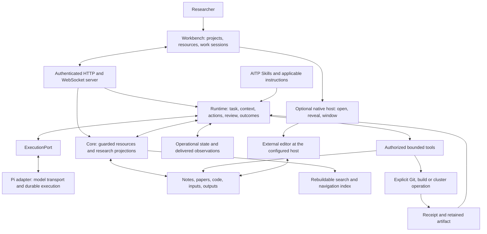
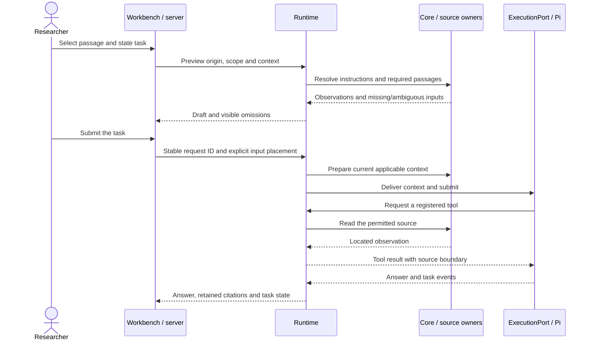
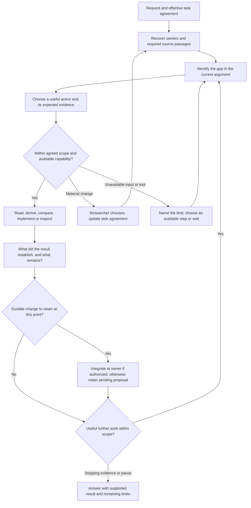

# 10. Target architecture: a project-centred research IDE

Living architecture, updated 2026-10-22. This is the canonical explanation of how the completed AITP-agent should work: its capabilities, component cooperation, data ownership and boundaries. The target remains a design proposal pending the researcher's implementation decision. [14 Development plan](14-implementation-blueprint.md) owns current progress and sequencing; [13 Research cases](13-research-journeys.md) owns case-by-case suitability and coverage. The existing implementation and its evidence remain in [the integration record](../../agent/notes/integration.md). The researcher authorized the standalone repository extraction and public release, including packaging path changes. That scope does not start a product milestone or research-note migration; the original worktrees are retained.

The product is a place to return to a scientific question, inspect what supports the current answer, and carry out the next authorized piece of work. A project opens on its research state. Papers, knowledge, notes and code have independently usable workspaces. A conversation is work on a selected object and can sit beside its material; it is never the prerequisite for finding that material.

## Design package and evidence

| Document | Responsibility |
| --- | --- |
| [11 Research memory](11-research-memory.md) | Object ownership, format alternatives, trial limits, identities and migration |
| [12 Desktop interface](12-desktop-interface.md) | Screens, transitions, layout alternatives, components and visual acceptance |
| [13 Research cases](13-research-journeys.md) | Concrete scientific situations, required cooperation, implementation coverage and suitability checks |
| [14 Development plan](14-implementation-blueprint.md) | Current progress, next scope, dependencies, evidence and implementation gates |
| [Isolated prototype](prototype/README.md) | Synthetic interaction demonstration, run instructions and tested limits |
| [15 Design review](15-design-review.md) | Astra critique, disposition and remaining decisions |

Evidence categories used throughout: **observed** means inspected code or retained experiment; **recorded** means a prior result whose original run was not repeated here; **inference** is an architectural judgment; **proposal** requires design approval; **open** is a decision or evidence gap. Public examples are synthetic. The real-note examples and trial outputs remain in the established private design/build record.

## What AITP-agent should add

The additional value is a research workspace that consistently connects scientific state to the work that produced it. A model can help derive an equation, read a paper or modify code in either host. Codex already supports project/file context, persistent chats and reusable Skills; these are not unique AITP-agent capabilities. The official [project documentation](https://learn.chatgpt.com/docs/projects) and [Skill documentation](https://learn.chatgpt.com/docs/build-skills), checked on 2026-10-21, establish that baseline. AITP's existing Markdown Skills can also guide those hosts.

The product hypothesis is that dedicated research objects, views and coordination reduce repeated context reconstruction, lost qualifications and manual linking across work. It does not establish stronger physics reasoning from the same model. Each proposed benefit must survive a concrete case and comparison with the researcher's existing Codex/Claude Code workflow, including the AITP Skills they already use.

| Added research capability | Concrete benefit to demonstrate | Cooperating parts and cases |
| --- | --- | --- |
| Return to the scientific frontier | Find what is established, why a thread is waiting and what remains authorized without reading several chats | Source projections + project/thread views + session/task context; [C01](13-research-journeys.md#c01), [C02](13-research-journeys.md#c02) |
| Follow an argument to its support | Open the exact argument/paper edition/code range used, retain its assumptions and distinguish it from today's changed source | Resource references + retained observations + reader/citation UI; [C04](13-research-journeys.md#c04), [C06](13-research-journeys.md#c06), [C07](13-research-journeys.md#c07) |
| Connect formulas, implementations and observations | Inspect a formula, actual checkout, calculation inputs and diagnostics together; identify the missing validation | Code/works/run adapters + source-aware editors + bounded tools; [C08](13-research-journeys.md#c08)–[C11](13-research-journeys.md#c11) |
| Track computational coverage and physical acceptance separately | Know which points ran, which checks passed, which comparisons are valid and which scientific claim remains unsupported | Receipts + coverage adapters + explicit acceptance passages + qualified outcome; [C09](13-research-journeys.md#c09), [C10](13-research-journeys.md#c10) |
| Preserve a reading and learning trajectory | Keep exact edition/page, prerequisites, unresolved derivation steps and researcher feedback across discussions | Library + reading notes + knowledge + learning Skill; [C03](13-research-journeys.md#c03)–[C05](13-research-journeys.md#c05) |
| Browse a knowledge wiki and literature library independently | Find a concept or paper, follow its prerequisites and sources, and return without creating a project or chat | Global resource indexes + knowledge/works adapters + shared readers and navigation; [C19](13-research-journeys.md#c19), [C21](13-research-journeys.md#c21) |
| Inspect and maintain existing knowledge | Review the exact support and missing conditions of a selected entry, retain unread boundaries and propose a scoped correction | Knowledge/source comparison + review coverage + existing proposal/application flow; [C20](13-research-journeys.md#c20) |
| Make research review actionable | Give an independent reviewer the relevant source/log, retain objections and assess which proposed passages actually change | Review execution + proposal revisions + author assessment + controlled application; [C12](13-research-journeys.md#c12), [C15](13-research-journeys.md#c15) |
| Reuse research without duplicating its conclusions | Locate a reusable result or demonstrated method, preserve its conditions, and update affected uses when it changes | Knowledge/where-used views + source owners + distillation/review; [C13](13-research-journeys.md#c13), [C14](13-research-journeys.md#c14) |
| Continue across sessions and tools | Keep the scientific owner and task boundaries through interruption, delegation and external editing | Runtime recovery + exports + host adapters + ordinary files; [C16](13-research-journeys.md#c16)–[C18](13-research-journeys.md#c18) |

A feature earns its place when a researcher can complete one of these cases with fewer wrong destinations, repeated explanations or lost conditions. Faster generation, a successful job, more agents or a polished dashboard does not by itself demonstrate that benefit. [13](13-research-journeys.md) records failures and remaining gaps so the architecture can be revised when a case does not fit.

### How this architecture governs development

Before changing behavior, identify the affected boundary here, the authorized slice in 14 and the case in 13. Preserve the accepted boundary during implementation. If a change needs a different contract, explain and revise that decision before dependent work; do not silently use documentation edits to ratify an unauthorized expansion. Routine corrections inside the agreed slice proceed normally.

Update the affected architecture passages, progress state and case coverage **in the same working change**, before handing it off or calling it complete. Unchanged documents need no ceremonial edit. Exact API payloads belong in protocol schemas and service contracts, detailed test receipts in implementation notes; link them here rather than copy them. The repository instruction is [AGENTS.md](../../AGENTS.md). Earlier 01–09 remain useful implementation/design references, but this architecture and 14 own the current target and sequence; neither an old document nor a proposed type changes the currently implemented API.

### What the existing foundation establishes

Observed: `agent/packages/core/src/notes/index.ts`, `locations/index.ts`, `paths/index.ts` and `index/index.ts` implement bounded source reading, discovery and search. `runtime/src/sessions`, `context`, `cards` and `compaction` plus `pi-adapter/src/port.ts` implement the session/context seam. The server and small React UI connect them. `protocol/src/sessions.ts` already distinguishes task, interjection and continue, and steer versus follow-up. The proposal preserves these distinctions.

Observed: documents, action authority, research adapters and worker execution are largely placeholders. `runtime/src/review/index.ts` exports a session and queues a request; that is not an executed independent review. `App.tsx` currently navigates home/board/settings/group/topic/note; it has no first-class thread, resource editor group or project work-session model. Moving the same dock to another side cannot supply those objects.

Recorded: the live read-only pilot, restart and compaction tests are in the integration record. Exact historical and standalone packaging test receipts have separate scopes linked from 14. The former 40-main-note threshold was derived from an inconsistent inventory. Replace it in a future approved test change with explicit expected/missing/excluded locations, rather than lower a number to manufacture success. These implementation checks remain useful; they do not decide product suitability.

Observed limits matter to the target flows: the CLI permits only the read-only profile, while full startup reaches unimplemented document recovery and action scanning. Session creation still requires a recognized research location; Global origins are proposed. Current context heuristics neither guarantee full-account delivery for restructuring nor block completion when a critical premise is omitted. The actual reviewer exports a session and queues a request. No diagram below should be read as evidence that these missing services already work.

**Inference:** Pi and the server can be retained. The research projections, context entry points and UI need substantial design changes. The current Skills carry scientific judgment; neither a relational graph nor a UI state machine can decide that a theory is established.

## Transfer from the reference applications

References were inspected on 2026-10-21. These are sources for interaction choices, not proof that AITP already has the features.

| Source | Pattern observed | AITP decision |
| --- | --- | --- |
| [OpenAI projects and chats](https://learn.chatgpt.com/docs/projects) | Project organisation and associated conversations | Keep project navigation and conversation history distinct; open the scientific overview on entry |
| [OpenAI code review](https://learn.chatgpt.com/docs/code-review?surface=app) | Explicit unstaged/staged/commit/branch/last-turn scopes; line-specific review | Label repository scope and attribution. A workspace diff is not automatically the agent's work |
| [VS Code user interface](https://code.visualstudio.com/docs/editing/getting-started/userinterface) | Persistent explorer, editor groups, tabs and keyboard navigation | Resources and work sessions share an editor area; two panes can compare different kinds of evidence |
| [VS Code WSL](https://code.visualstudio.com/docs/remote/wsl) | UI and tools can run on different sides of the Windows/WSL boundary | File access and Git execute with the filesystem host; the renderer receives resource identities |
| [ZCode source](https://github.com/zai-org/ZCode), especially `DESIGN.md`, `docs/design/workspace-independent-panels.md`, `docs/workspace-entry-draft.md` and `packages/ui/src/app-shell/WorkspaceShellLayout.tsx` | Semantic UI tokens, independently resizable panels, workspace identity and restored layout separated from session creation | Use a shared shell and explicit host identity; opening a project must neither send a prompt nor create a formal session |

The inspected ZCode archive is an earlier downloaded snapshot of its main branch; it is not claimed to match today's HEAD. The transfer above uses its design and source, not a live ZCode usability trial. VS Code's extension ecosystem and ZCode's provider/runtime architecture are not copied. AITP retains its own execution port and research policy.

## How the completed system fits together

The application is now maintained in its own repository. The pinned `aitp/` submodule
links [AITP-Research-Protocol](https://github.com/bhjia-phys/AITP-Research-Protocol),
whose `plugins/aitp/` owns portable scientific Skills and reviewer guidance.
The CLI resolves that checkout separately from application assets; a configured external
AITP checkout is also supported. Scientific instructions enter the existing instruction
and context services. The submodule does not supply the missing application reviewer,
resource adapters or authoring services.

This is the target cooperation diagram. The current implementation covers a subset identified in 14 and each case in 13. It remains one local backend with a shared renderer, not a separate service for every box.



The protocol package defines the serializable boundaries used by these components; it is not another coordinator. Runtime asks Core for source interpretation and access, and asks the execution port to run model work. Pi supplies execution machinery; it does not decide scientific ownership or acceptance. A model-requested tool returns through the runtime boundary before filesystem/process effects. Browser navigation and native IPC do not bypass that boundary.

### Responsibilities and connections

| Component | Responsibility in the completed product | Connections and boundary |
| --- | --- | --- |
| [Workbench](../../agent/apps/workbench/src/App.tsx) | Project state, threads, resource readers, shared editor groups, session view, context/proposal inspection | Calls typed server operations; stores layout/drafts, not accepted scientific conclusions or credentials |
| [Server and composition](../../agent/packages/server/src/compose.ts) | Authenticate clients, validate routes/events, deliver resources, compose one backend, order startup/recovery | Resolves current backend state for clients; native and browser clients share the API |
| [Core](../../agent/packages/core/src/contracts.ts) | Read and interpret source owners; resolve references; expose notes, library, knowledge, checkout, run and manuscript adapters | Uses configured filesystem authority; provides explicit missing/ambiguous/unsupported results; derived relations never prove a theorem |
| [Runtime](../../agent/packages/runtime/src/contracts.ts) | Own active tasks, context preparation/delivery, waiting choices, proposals, review/application, receipts and outcomes | Combines Core data with actual instructions and task scope; defines tools and admission; never delegates permission to retrieved text |
| [Pi adapter](../../agent/packages/pi-adapter/src/port.ts) | Implement model transport, durable conversations/tasks, interruption, compaction hooks and export through `ExecutionPort` | Only production package importing Pi; runtime policy remains outside it; provider credentials remain backend-owned |
| [Protocol](../../agent/packages/protocol/src/index.ts) | Resource/locator types, messages, task/action/proposal records, route/event validation | Shared by all layers; change schemas and consumers together after the contract is settled |
| [AITP Skills](../../aitp/plugins/aitp/README.md) | Research methodology: read the whole affected argument, distinguish proof/control/interpretation, retain failed routes, choose what to record | Same source guidance remains usable in Codex/Claude Code; a Skill instruction is not a hard runtime check until a service enforces it |
| Host and external tools | Native window actions; optional code editor; bounded scientific processes and later cluster adapters | Every operation names its actual host/root; renderer has no arbitrary shell bridge; local UI disconnect is not process cancellation |

Core has no dependency on model transport. Runtime depends on Core and protocol and programs against the execution port. The server is the composition root for Core, runtime and the Pi adapter. Workbench consumes protocol and the API rather than importing backend services. The native host is optional. Existing [package boundaries](02-architecture.md#packages) and [contract code guide](09-contracts.md) remain relevant where they agree with this target.

### Capability cooperation

The **project view** is a projection of the main note's question, qualified answer and Current work. Its thread links lead to the owning passage, related evidence and operational sessions. The **library** locates a work and a specific edition; its reader produces an edition-bound selection. The **knowledge view** finds explanations and conditions reusable across projects. These share references, but a source reading, a proposed idea and an accepted result remain different kinds of material.

Global **Knowledge** and **Library** are independent entry points. Their indexes read existing owners through Core; collection filters, cross-links, outlines and back/forward navigation use the shared resource resolver and editor state. The knowledge route can run from a subject to a concept, its prerequisites and the original derivation. The library route can run from a collection to a work, a particular edition and its source-ordered reading notes. Paper sections, equations and unresolved steps remain reachable; a wiki overview does not replace close reading. Unknown index coverage and unavailable files are explicit. Browsing does not create a session, mark material read or reorganize files.

A **knowledge review** starts from a selected passage or bounded collection, even when no edit has been proposed. Human inspection uses the same source comparison panes. A requested model review passes that scope and source observations to Runtime's independent reviewer; its findings identify what was actually inspected and which dependencies remain unread. A correction then uses the existing proposal, assessment and application flow. Bibliographic curation follows that flow for its named metadata owners. Search links and duplicate candidates are navigation aids, not judgments of scientific support or authority to merge records. P2 supplies reading surfaces; actual reviewer execution and writes retain the later gates in [14](14-implementation-blueprint.md).

The **code view** resolves the actual checkout, selected revision/diff and repository instructions. The **run view** connects inputs and execution receipts to retained outputs and the question they test. The **manuscript view** connects paragraphs, figures and citations to those owners. A figure is reachable through its data and generating procedure; an artifact receipt states what ran, while the scientific note explains what that observation supports. Missing provenance appears as a gap, never a green validity badge.

The **work-session view** brings these selections together under an explicit task. The **review and outcome flow** turns proposed changes into reviewable source edits or leaves a clearly named obstruction. The **method view** makes demonstrated procedures discoverable as Skills; it does not automatically install them or convert every successful conversation into a reusable method. All six resource activities remain useful without opening a conversation.

### Where information lives

| Information | Primary owner | What survives or changes |
| --- | --- | --- |
| Scientific questions, assumptions, arguments, outcomes and live continuations | Ordinary research notes and their supporting files | Remain usable without the application or its index; substantial changes are reviewed source edits |
| Paper content, reading notes and reusable knowledge | Existing library/knowledge owners with edition/source references | Reuse links to one owner; reading or attaching a file does not promote its claims |
| Code, calculation inputs, raw outputs and figures | Actual checkout and declared run/artifact locations | Preserve original material; Git history is optional and repository-specific |
| Conversations, tasks, delivered context, choices, proposal/review/action records | Backend operational storage through Pi/AITP state | Retain actual request and delivery observations across restart; losing the navigation index must not lose these records |
| Authoring baselines and retained output copies | Proposed observation/artifact stores | Opaque IDs; retain only what was actually captured. No content-hash check is reinstated |
| Search results, extracted project objects and where-used navigation | Rebuildable derived index | May be discarded and rebuilt; a stored edge is not independent scientific evidence |
| Open panes, scroll, filters and unsent drafts | Client view state | Restore presentation without submitting a task or granting permission |
| Configuration, root/host mappings and credentials | Backend configuration/credential stores | Mappings are explicit; secrets never enter scientific notes, prompts or renderer storage |

Current source and delivered observation are separate objects. Reading a file again does not retroactively change what an earlier answer used. A timestamp records observation time, not proof of identical content. References distinguish a path/anchor, an edition/page and a captured excerpt instead of pretending they are interchangeable.

### Three complete paths through the components

**Return and read.** Opening a project asks the server for a Core projection. Core resolves the source owner through guarded paths and returns source passages, locators and unresolved references. The UI renders those passages with their qualifications. Choosing a thread opens its owner and relevant sessions; nothing sends a model prompt. Selecting a paper or code range adds explicit source context only when the researcher chooses a work action. Case [C01](13-research-journeys.md#c01) can therefore fail on navigation or lost qualifiers before model quality enters the comparison.

**Ask a source-grounded question.** A draft carries origin, intent and selection. Runtime previews instructions, required material and omissions through Core. On submission it rechecks applicable context, records the request and delivered observations, and calls the execution port. A model tool request returns through runtime to the appropriate guarded adapter. The answer links to the observation used; the UI separately offers the current source. A missing critical premise yields a partial result or a blocked consequential action, not a claim of complete verification. The target sequence is:



**Investigate, review and update.** A numerical or code task begins with the scientific observable, scope and acceptance criteria, not with an unbounded shell request. Runtime admits only the authorized operation, records command/inputs/environment and exposes its actual receipt and output. An analysis may support a proposed conclusion, but runtime completion does not make it accepted. For an authorized substantive note revision, document services prepare a concrete proposal over the complete affected argument; a separate reviewer receives its relevant sources and log; the main agent assesses the report; required researcher choices remain pending. Application rechecks the approved scope and reviewed dependencies under the separately approved non-hash policy, writes through the document service, rereads the result and records any partial application. Core refreshes the affected projection, and the UI links the outcome back to the owner. A no-change or failed result can close the operational task while leaving the scientific question open. [C09](13-research-journeys.md#c09), [C10](13-research-journeys.md#c10) and [C15](13-research-journeys.md#c15) test different parts of this path.

### Coordination when something changes or fails

| Event | Required cooperation and visible result |
| --- | --- |
| A source changes outside AITP | Core rereads on use/refresh; UI distinguishes current content from retained observations. Later review/apply checks declared affected dependencies; no hash or silent auto-rebinding |
| A premise is absent or excluded by the context budget | Context service retains the exact omission; partial work stays labelled. A complete verification/restructure/apply claim waits for actual required reading |
| A task needs a consequential choice | Runtime persists the question and waiting state. An interjection can answer status without replacing the task or answering the choice |
| Client disconnects or a tab closes | Backend remains authoritative for execution; reconnect queries retained task/action state before offering a retry. Draft/layout recovery never submits again |
| Backend restarts after a possible external effect | Proposed full startup recovers local journals and reconciles uncertain effects before scheduling. Unknown remote outcome is not replayed as a fresh submission |
| A reviewer fails or omits relevant sources | Review coverage remains incomplete; a queued request or demo review label cannot open the application gate |
| A source moves, an anchor is duplicated or a host is unavailable | Resolver reports unresolved/ambiguous/unavailable with the original reference; recovery requires an explicit mapping or selection, not a title guess |
| Evidence overturns an earlier conclusion | Find source-backed uses, propose corrections at the owning claim and affected uses, preserve the failed route. Relations help find candidates; the researcher/agent still assesses their scientific consequence |

These are target guarantees with tests in 14 and cases in 13. In particular, current `whereUsed` discovers links in known main notes, not a complete semantic dependency graph; current context preparation uses English intent heuristics and explicit scoped files, not a proven whole-argument readiness check. Test meaningful Chinese and English tasks against the same source requirement. No component can automatically certify a proof, thermodynamic limit or physical interpretation merely by transitioning a task to complete.

## The object model

Three kinds of record have different owners:

1. **Scientific record:** ordinary files hold questions, arguments, evidence, qualified answers, decisions and continuations. AITP, Codex, Claude Code and the researcher read the same owners.
2. **Operational record:** the runtime owns conversations, active tasks, delivered context, actions, proposals, review reports and outcomes. An outcome links to science; an assistant message does not itself update scientific state.
3. **Disposable projections:** parsed objects, search, where-used links, previews and navigation are rebuildable. Losing this index loses convenience, never an accepted result.

| Concept | Meaning and owner | What it is not |
| --- | --- | --- |
| Project | Durable workspace initially associated with a top-level topic folder; its home is an existing main note or family README | A session or automatically generated summary |
| Direction | A question or programme grouping, expressed in source links | A mandatory extra directory level |
| Subproject/branch | A question with its own argument and main note; may have several scientific parents | Every subdirectory |
| Thread | A continuation owned once by a Current work entry | The latest chat or scheduled job |
| Open question | An unresolved scientific issue anchored in the argument | A to-do that must immediately be assigned |
| Idea | An uncommitted seed; discussion can end without promotion | Authorization to create a branch |
| Decision | Scope, choice and rationale at the passage whose meaning it changes | A permanent grant to execute |
| Evidence | A derivation, located source, report, receipt or result with stated limits | Automatically supporting every linked claim |
| Knowledge entry | A reusable explanation/result in the shared collection, with support/review labels | A duplicate project conclusion |
| Work session | Runtime conversation started from an origin and intent, carrying an authorized task | A replacement for the owning scientific note |
| Activity | A dated read, run, change or commit | Scientific progress measured by volume |

Relationships follow the canonical vocabulary and source rules in [11 §3](11-research-memory.md#3-objects-and-relationships). An ordinary link initially means only `links-to`. Stronger relations require an explicit source statement; a proposed scientific relationship is integrated into its source before appearing as accepted. Cross-project membership uses references to the same object. No content is copied to populate another project.

### Identities and discovery

Use the existing `ResourceRef`/locator idea, extended as described in 11. An identity includes the filesystem authority and configured root, then relative path and optional explicit anchor. A stable human-readable anchor survives heading renames; path fallback keeps old notes usable. No hash-derived identity or content certification is introduced. A move without a recorded alias yields an unresolved reference, never a guessed replacement. Duplicate anchors produce a diagnostic and require disambiguation before edits.

Projects may be note-backed, family-map-backed or learning-story-backed. A family README does not acquire a fictitious umbrella hypothesis. An unattached paper or code checkout is browsable globally; starting work there uses a global research context, not a fabricated topic. Scope is supplied by applicable instructions and the actual request.

Discovery follows configured roots, root/README links and explicitly attached paths. It excludes snapshots and output forests by policy and reports exclusions. A bounded Unmapped list exposes relevant note candidates without silently promoting them. Global search uses notes/library maps/selected checkouts, never an unbounded crawl of run data.

## One interface, six independently navigable resources

The activity rail opens Projects, Literature, Knowledge, Notes, Code and Work sessions; Search is global. Project selection supplies an optional filter, not a prerequisite. Each activity changes the explorer, while the shared editor groups retain open resources. The header always shows the active project or Global and the current host. A paper opened from a second project is the same edition, with a different referring context.

```text
Application shell
  ├─ project/resource explorer ── sourced objects and links
  ├─ editor groups ───────────── overview | thread | note | PDF | code | session
  ├─ optional inspector ──────── evidence | relations | history | context
  └─ optional activity panel ─── actions | runs | problems

Selected object → prepare work → visible task + source selection → durable session
                                  ↓
                    proposed outcome → review/authorized application → source owner
```

A project overview has the question, qualified current answer and decisive gap, then active threads and pending decisions. It displays source passages with their caveats. Long passages expand in place or open the owning note; a character cutoff may never turn a conditional result into an unqualified headline. Ideas and related subprojects follow, with activity in a secondary region. There is no completion percentage for a research project.

The useful difference from a note reader is testable: entering a thread locates its current owner, limiting evidence and relevant past work without explaining filenames to a model; the researcher can inspect a source and code side by side before starting a session; after a session, an explicit outcome links the changed argument to the actual artifacts. Merely adding colourful cards does not meet that test.

## Work-session and context architecture

The origin is a project, thread, idea, paper passage, note range, code selection/commit, run or knowledge entry. Intent is explore, learn, derive, verify, implement, review or write. Intent selects a context recipe and presentation, not new authority. A single concise composer shows the task draft, origin and optional material chips. Detailed context and scope are expandable; ordinary reads do not require a wizard.

| Intent | Mandatory context, beyond applicable instructions | Failure that must remain visible |
| --- | --- | --- |
| Status/continue | Owner opening and Current work; operative plan/choice; parent using passage when relevant | Missing owner or unanswered choice; Continue cannot silently pass it |
| Derive/verify | Exact selected argument, assumptions/conventions and cited premises; earlier failed route | An unresolved premise remains unresolved, including when a model sounds certain |
| Read/learn | Edition, selected passage and locator, paper map and requested prerequisites | Missing full text or ambiguous printed/PDF page |
| Implement/review | Actual checkout/branch, selected code/diff, scientific formula, repository instructions, relevant receipt | Dirty changes from other sources; no invented attribution |
| Write | Complete affected argument, proposed scope, citations and dependent passages | A partial excerpt is insufficient for restructuring |
| Explore | Seed and relevant local context, explicitly uncommitted task | No branch or note is created just by starting the chat |

Project/library context and session/task context are independent. Switching projects or tabs never mutates a running task or its granted roots. Adding a selected paper to a busy session creates a queued submission with that material, preserving `InputSubmission` placement semantics. Interjections retain `ActiveTask`; an explicit new task changes it. A new conversation inherits scientific context but not another conversation's execution grants.

Context assembly uses existing instruction/data separation, bounded budgets and the recorded manifest. Origins and recipes extend `SessionMeta`; global origins use the explicit `ContextHome` union below instead of faking a workspace path or relying on two independent optional fields. A draft can be abandoned without creating a runtime conversation. Once sent, `create/submit` receives a stable request ID; reconnect does not submit twice.

On resume, show the retained task and reread current sources. Recorded observations and current text remain distinguishable. The inspector can show what was delivered at a particular request, including omissions. Hash checks are disabled: observation time is not proof of unchanged content, and a current-file citation is not an immutable snapshot. Where exact prior text is retained, give it an opaque observation/snapshot ID and the captured excerpt. Historical Git references identify commits without treating them as authority for execution.

<a id="research-control"></a>
## Research decisions, constraints and the next useful action

**Researcher-selected default, 2026-10-21:** the researcher and agent establish the objective and boundaries;
the agent autonomously chooses routine next actions within them. A material change to core assumptions,
algorithm or research direction returns to the researcher for discussion before dependent work. This choice
settles the default delegation policy, not approval to implement the application or start a new research
campaign. A task may explicitly narrow or broaden that delegation. A status question or a new UI selection
does not silently change it.

The intended control loop is adaptive. It should help answer: *what is currently missing from the argument,
which action could remove that uncertainty, and would success actually advance the original question?*
An intent such as `derive` supplies useful initial context; it does not lock the session into one tool family.
A derivation may need a source check and a code comparison may reveal a missing analytic premise. Fluent work
continues without a planning ceremony after every tool call. Reconsider the next action when evidence,
an obstruction, an applicable constraint or the purpose of the task changes.



This is cooperation inside the existing Runtime and model turn, not a new autonomous supervisor service.
The language model, guided by relevant Skills, proposes the scientific gap and next action. Core resolves
and reads the actual sources. Context records what was supplied and what is missing. Runtime enforces
the applicable action boundary. Review challenges consequential reasoning and source changes. Pi supplies
execution and persistence, not a scientific choice function. An unavailable capability produces a visible
limit; no route choice fabricates a successful lookup, run or review.

### Working state and the researcher's freedom

Extend existing `ActiveTask` and context records, rather than add another scientific-state database:

| Task information | Owner and update rule |
| --- | --- |
| Objective and effective agreement | Existing task state, with references to the actual user request and subsequent choices; retain allowed actions/roots, binding exclusions, resource limits, delegated choices and stopping conditions when stated |
| Scientific setting and current supported answer | Source passages in the owning note; runtime carries references and observed excerpts, not a second editable answer |
| Present gap, candidate action and reason | Revisable model working state associated with the task; show the proposed next action and what it could establish when useful, without treating the suggestion as a user decision |
| Required inputs and coverage | Existing context manifest extended with operation-specific requirements and delivered observations; distinguish missing sources from optional background |
| Action outcomes and pending integration | Existing events, receipts, proposals and outcome references; a completed reply or tool call does not mean the research note changed |

A clear user choice updates the effective agreement once, preserving the parts it did not change. Associate
the update with its request/answer and an opaque revision, not a digest. Context, reviewer and any later
worker receive the same effective scope. Before a queued action executes, check the then-current scope;
an earlier queued suggestion cannot override a later restriction. An ambiguous consequential change pauses
only the dependent action. Routine source reads, derivations and implementation already authorized continue
without repeated permission. Operational agreement state is a projection of actual instructions, never a
grant synthesized from a paper, search result, historical success or model-generated plan.

Two independent questions determine freedom: **which actions are allowed**, and **which decisions have been
delegated**. An analytic-only task may allow broad analytic exploration while excluding numerical execution.
A tightly chosen numerical method may allow implementation and diagnostics while reserving solver changes
for discussion. An explicit comparison of candidate methods permits that comparison within its stated budget;
it does not automatically adopt a winner. A working hypothesis may be explored provisionally without being
promoted to the governing assumption or an established result. New independent investigations remain scope
choices. These distinctions should be inspectable and adjustable per task, not hidden in a permanent mode.

### Choose actions from the gap, not a prescribed sequence

The following are decision aids, not mandatory phases or an exhaustive physics classifier. Other actions
can be proposed with the same explanation of purpose, required evidence and scope. Prefer an informative,
proportionate step whose possible outcomes would change the judgment; do not invent numerical scores for
its expected information value.

| Present uncertainty | Useful next action | Return or reconsider when |
| --- | --- | --- |
| A definition, convention, existing result or failed route has not been recovered | Read the owning note and relevant personal-knowledge entry; use its index once and follow the needed sources | The needed premise is recovered, or local coverage is insufficient/contradictory; absence of a search hit is not absence of knowledge |
| An imported theorem, citation, edition, novelty claim or missing background is uncertain | Inspect the stored original source; search primary literature when the source or coverage is insufficient | The relevant scope or precise unresolved issue is known; do not expand into a survey that no longer serves the question |
| Definitions and premises are available but the decisive inference is missing | Derive it, examine a counterexample or a faithful special limit; use permitted computational checks only if they address the inference | A result or specific obstruction appears; failure of one ansatz is not failure of every possible argument |
| A formula disagrees with observed program behavior | Trace the actual code path, inputs, conventions and observable against the formula and retained output | The discrepancy is localized; repair the agreed implementation or discuss a consequential method change before adopting it |
| The intended method, inputs and discriminating validation are settled | Implement the bounded change and perform relevant checks | A check fails or an unresolved solver/truncation/acceptance choice changes the task; software success alone does not settle the physical claim |
| Work has consequential dependencies, multiple sessions, costly actions or competing routes | Make or update a concise plan in the existing owner, then execute its authorized parts | Evidence invalidates a premise or a required choice remains open; a one-step routine fix needs no separate plan document |
| A new, changed or disputed consequential claim is about to support a decision or main account | Perform a relevant independent check or scoped scientific review | Its actual support and limitation are known; model agreement and a review label are not proofs |
| Repeated steps no longer change the scientific judgment | Ask what perfect success would establish about the original question; inspect retained failures and alternatives | Select a discriminating step, retain a precise obstruction, or discuss a material route change rather than expand an uninformative scan |

Choosing literature versus derivation is normally the agent's job under the selected default. Choosing a
different physical model or a consequential solver is a researcher decision unless explicitly delegated.
Missing evidence should prompt investigation; missing intent may prompt a question. Do not ask the researcher
to vote on the truth of a theorem or use their choice as evidence that a physical interpretation is correct.

### Detect shortcomings at the inference where they matter

Scientific scrutiny uses relevant Skills and the actual argument. Introducing an imported result should
expose its hypotheses, conventions and source. Interchanging limits calls for its justification. Moving from
finite observations to a general statement calls for the missing extrapolation or theorem. Comparing code
with theory requires the executed map, boundary conditions and observable. A small residual, matching plot
or passed test may establish a narrow fact while leaving the physical selection or interpretation open.
These triggers guide a targeted check; they are not a checklist repeated for every ordinary response.

When a premise is missing or disputed, retain the exact claim, the needed evidence and which inference
depends on it. A discovered contradiction should first be checked for different versions, assumptions or
conventions. Review both sides; neither recency nor majority agreement chooses the scientific answer.
Stop investing in the affected inference when its prerequisite is invalid, while continuing independent
work within scope. Later correction updates the owning argument and actual dependent uses, as
[11](11-research-memory.md#memory-writeback) specifies.

| Enforcement level | What the system can do | Limit |
| --- | --- | --- |
| Runtime boundary | Enforce resolved task/action scope, paths, available capabilities, configured budgets, pending required choices and write restrictions at the actual tool boundary | Natural-language interpretation and semantic method changes cannot be recognized perfectly; uncertain consequential mappings must stay visible |
| Context readiness | Require actual observations for the declared necessary passages; keep pointer-only, omitted, unavailable and superseded inputs distinct; withhold complete-review/authoring readiness for an unmet requirement | Delivery does not prove comprehension, and the declared dependency set may omit a hidden premise |
| Scientific scrutiny | Select relevant checks, surface counterevidence, retain qualifications and obtain independent review where warranted | It remains fallible scientific reasoning; no state transition can certify a proof or discover every physical defect |

In particular, the implementation can prevent its UI or application gate from claiming that declared reading
requirements were met when they were not. It cannot mechanically prevent every unsupported sentence a model
generates. Source-fidelity and overclaiming therefore remain evaluated behaviors with human review, separate
from hard tool-policy tests. A partial context can support a bounded explanation or search for missing
material; it must not freeze the entire investigation or silently become a complete verification.

### Present implementation boundary

The current [context service](../../agent/packages/runtime/src/context/index.ts) assembles candidates and
records delivery/omission, but its English rewrite heuristic suppresses excerpts without guaranteeing whole
argument reading, and its budget can demote a decisive premise. Current
[task reconstruction](../../agent/packages/runtime/src/sessions/index.ts) retains the latest task request;
[choice answers](../../agent/packages/runtime/src/cards/index.ts) persist as inputs, without a structured
effective-agreement revision. [Tool guards](../../agent/packages/runtime/src/compaction/index.ts) cover a
limited set of mode/tool exclusions. [Review](../../agent/packages/runtime/src/review/index.ts) queues and
exports; it does not run the reviewer. Action authority and document application remain placeholders.

Consequently this loop is a proposed refinement of the existing architecture, not an implemented research
controller or an empirically established improvement in scientific judgment. [14](14-implementation-blueprint.md)
places its read-only scope/context seams in P1, material retrieval in P2, review/writeback in P3–P4 and later
long-running/parallel execution in P5. The [cross-case exercises](13-research-journeys.md#adaptive-research-checks)
specify how evidence changes should alter behavior without demanding one exact tool sequence.

## Module boundaries and API evolution

Keep the existing seven-package structure. This is a modular monolith, not a fleet of services.

| Boundary | Proposed addition | Existing owner/reuse |
| --- | --- | --- |
| Protocol | `ResearchObjectRef`, `WorkOrigin`, source-backed relation/projection, optional global origin and session outcome | `protocol/src/refs.ts`, `research.ts`, `sessions.ts`, route/event tables |
| Core | Project/object projection, explicit-anchor resolution, bounded resources and where-used queries | `core/src/locations`, `notes`, `index`, future works/knowledge/checkouts |
| Runtime | Origin-specific context preparation, outcomes with evidence, reviewer execution and application gate | `runtime/src/context`, `sessions`, `review`, `actions`; no provider logic here |
| Server | Authenticated resource resolution, paged projections and binary range serving | Current Host/Origin/auth/path guards and HTTP/WebSocket composition |
| UI | Shell, explorer registry, editor registry, inspector and scoped state store | Existing Markdown renderer, sign-in, API stream, session composer logic |
| Host adapter | Open external editor/file, reveal path, window lifecycle and notifications | New narrow capability interface; absent in ordinary browser mode |
| Pi adapter | Preserve conversation/task/delivery/compaction port | No UI objects imported into Pi; only runtime translates origins into context |

Proposed operations are `listProjects`, `getObject(ref)`, `listRelated(ref, relation, cursor)`, `prepareSession(origin,intent,selection)`, `listSessions(origin)` and `resolveResource(ref)`. Preparation is read-only and returns task draft, instruction/data refs, missing inputs and estimated omissions; it does not create a task. Actual submission remains the current session input path. Reads return `observedAt`, source locators and unresolved diagnostics, never a fabricated successful empty response for an unimplemented adapter. P1 contracts are reviewed code before concurrent implementation, as in W0.

UI layout is local view state: editor groups, focus, project filters, scroll, draft and resource locators. It stores no scientific answer. Operational metadata has a schema version and export path; an unavailable index can be rebuilt. Existing sessions remain readable through compatibility fields; global sessions are a versioned addition. Do not migrate runtime stores in this design phase.

### P1 contract decisions: origins, authority and citations

The following is the proposed version-2 design contract, not implemented TypeScript:

```text
ContextHome = { kind: note, resource: ResourceRef }
            | { kind: global, workspaceId: configured workspace identity }
WorkOrigin  = { kind: project|thread|idea|paper|knowledge|note|code|commit|run,
                resource: ResourceRef, selection?: Locator }
SessionV2   = { version: 2, contextHome, origin, displayProjectId?: ProjectRef,
                ...existing session fields except required location }
FileAddressV2 = { hostId, rootId, relativePath }
```

`FileAddressV2` is shorthand for a new file-address variant inside the existing `ResourceRef`, not a parallel reference type. `ResourceRef` remains the sole owner of locators, editions and resolution; adapters do not invent another locator normalizer. Host/root IDs are opaque configuration identities, not hashes or paths. A configured path may change without changing its root identity only through explicit mapping repair. P1 has one authoritative WSL/local host; multi-host attachment is a later named capability. Absolute paths remain server-resolved compatibility inputs. No identity inferred from a Windows path can silently target a WSL root. Two roots with the same relative filename remain distinct.

Read legacy `location` sessions as note-home sessions under their original configured root; do not rewrite them on read. Global work uses the actual workspace instructions plus the requested resource's applicable instructions and scope, with no fabricated `research.md`. The server resolves instruction applicability; the UI's project filter and `displayProjectId` cannot grant authority. A selected code checkout adds its repository instructions for work there. Attaching a paper adds data, not permission or instruction authority.

Scope comes from the actual user task and applicable authored instructions: configured workspace/physical containment, the task's owning note and operative agreement, and explicit constraints that govern the selected operation. Scientific parent and `links-to` edges are not an instruction inheritance graph. Read a parent's using passage for scientific context without automatically importing unrelated sibling restrictions or grants. When several applicable constraints conflict, retain them visibly and pause the affected operation for clarification; continue independent read-only inspection where allowed. Do not silently select the permissive parent or let a mode label override analytic-only scope. New task authority and material scope changes require the actual researcher's request. Resume rereads applicable instructions and reports a material conflict before execution; stored historical permission alone is insufficient.

Before sending, source preparation returns the full proposed context and omission list. Sending uses a request ID; the existing `ContextService.prepare(session,input)` remains the placement-time operation after session creation. A new `previewContext(home,origin,intent,selection)` supplies draft inspection without creating a session or persisting authority. Do not rename the existing method while changing its semantics implicitly.

Global instruction resolution must explicitly load workspace policy even without `target.location`; the current resolver's location-guarded branch is not sufficient. Resource/repository instructions are added from the resolved target, not from the last selected sidebar project. Test a global library session while an unrelated analytic-only project is selected, and a code-origin task with relevant repository constraints.

Recipes distinguish critical premises/scope from optional background. Preparation returns `ready` or `partial` with exact missing/omitted critical inputs. A pointer substituted for unread required argument is not successful delivery. Bounded exploratory/status answers can proceed with those limitations stated; source-complete verification, restructuring readiness and later apply remain unavailable until the required material has actually been read. Large accounts can be read in coherent stages with recorded observations and unresolved dependencies; listing their references alone does not count. Test token-budget omission of a decisive premise and confirm the UI retains the omission and the result cannot be presented as complete verification or an apply-ready rewrite.

P1 citations use existing retained delivered data and session entry/block IDs. A citation carries its current `ResourceRef` and, when available, a delivered observation locator (session, entry/block, excerpt range and observed time). Opening an answer citation defaults to that exact retained excerpt with “As used in this answer”; Open current source is a separate action. A full-file historical view is offered only if that file was actually captured. If old context is unavailable, state that explicitly and offer the current source without claiming it is identical. P3's opaque snapshot storage extends this capability for authoring baselines; P1 citation fidelity cannot wait until P3.

The Markdown navigation boundary must change in P1 even when the rendering pipeline is reused. Recognized safe anchor nodes are mapped to pane-local targets; arbitrary source HTML stays disabled. `openResource(ref, locator, group)` preserves cross-file fragments. DOM IDs include group/pane identity, so two views of the same note never scroll each other through global `getElementById`. Unresolved anchors open the source with a diagnostic. Acceptance includes two panes of the same note, cross-note durable anchors, and a scratch-source edit after delivery whose old citation still opens the delivered excerpt.

## Windows, WSL and the desktop host

Recommended deployment: retain the current WSL backend and web renderer, then place the renderer in a thin desktop host after P1's shell is accepted. A native wrapper is a proposal, not an existing deliverable. Prefer an Electron spike using the same HTTP/WebSocket API because it reuses the JavaScript stack; compare memory, packaging and WSL attachment before committing to it. A browser/app-window profile remains useful for development and does not satisfy every desktop acceptance test.

The backend owns canonical POSIX paths and runs Git in the checkout's environment. A host-qualified root map distinguishes Windows, a specific WSL distro and future SSH hosts. Never equate `C:\\...`, `/mnt/c/...` and `\\\\wsl.localhost\\...` by string replacement. The desktop bridge resolves an explicit configured mapping and passes structured argument arrays to allowed operations. Symlinks and path traversal are checked at the filesystem authority. Unknown/missing mappings open a clear unavailable state.

Renderer Node integration stays off. Credentials stay in the runtime credential store, not browser storage or deep links. Native IPC exposes only open/reveal/window actions after validating the resource; it is not a shell executor. Opening VS Code delegates its editing/debugging UI while AITP keeps the research context and rereads actual files on return. Native AITP code support starts with source, symbols, search, diff and history; full debugger/LSP/extension-marketplace parity is out of scope.

**P2d attachment decision:** the first native slice is attach-only. The researcher starts the existing CLI backend in the selected WSL distro and supplies its local bootstrap address; the host offers saved endpoint/distro profiles, connection diagnosis and retry. It does not execute a renderer-provided start command. A missing backend shows the exact selected profile and CLI startup instructions without creating a replacement workspace. Later one-click managed startup would be a separately approved fixed launcher capability, not an implicit requirement slipped into IPC.

The native window loads the existing authenticated backend HTTP origin on a configured loopback endpoint, preserving the server's Host/Origin checks and fragment-to-HttpOnly-cookie exchange. It does not use a packaged `file:` renderer plus a new cross-origin auth path. Bootstrap tokens are transient, removed after exchange and not written into logs; external authentication opens in the user's browser. The native bridge accepts calls only from that selected application origin; research HTML/PDF and external navigation receive no bridge. Windows–WSL loopback reachability and the configured distro/root identity must be tested on the actual host, not inferred from Linux-only browser tests.

Closing the last native window detaches the UI and leaves the independently started backend alive. Running work and its host are named before detaching; reopening reconnects to actual state. No claim is made that closing the window cancelled work. App-owned backend lifecycle, automatic WSL start and automatic distribution discovery are outside P2d and remain later host-policy decisions.

Disconnect preserves cached views labelled as observations, unsent drafts and task identity. It does not claim to abort a remote process. Reconnection queries task/action state before offering Retry; uncertain external effects require reconciliation. Closing a tab affects presentation only. Closing the app must expose any running work and whether its backend remains alive.

## History, writing and review

Local Git history is optional and requires separate approval of root, exclusions and checkpoint policy. No repository is initialized here. Notes, existing code repos and runtime stores remain independent. A note revision is associated with its exact change set and note commit if available; code commits retain their own repository identity. Runs retain receipts. Timeline joins are explicit links, not inferred from adjacent timestamps. Before note history exists, the UI says history is unavailable before the first retained observation.

Recommended authoring sequence: preview the affected source and dependent uses; independent read-only process review of substantial restructuring; main agent disposition; authorization within the actual task; apply through the document service; read back and record outcome. A reviewer must execute before accepting real authoring, not be postponed to advanced multi-agent work. Routine authorized small edits should not acquire redundant permission dialogs.

No hash/version/conflict/approval-digest checks are restored. Future exact anchored-text matching, current-source rereads, immutable proposal records and direct approved-argument equality are proposed alternatives, requiring approval with P3. They offer weaker guarantees than excluding arbitrary external writers; they cannot promise zero filesystem races or transactional multi-file writes. Ambiguity stops application and preserves the proposal. Recovery and rollback are new inspectable changes, never reset/restore over unrelated edits.

## Alternatives and decisions

| Choice | Alternatives | Recommendation and cost |
| --- | --- | --- |
| Research state | Database authority; YAML sidecar; stricter readable Markdown; distributed account | Recommend F2-style readable conventions with optional anchors and selective supporting notes, from 11's qualified assessment; preserve old formats |
| Main layout | Permanent chat dock; fixed workflow dashboards; shared resource/session tabs | Shared editors with optional inspector. Costs an explicit tab/focus model but permits work without chat |
| Scientific graph | Mandatory graph canvas; implicit prose only; typed sourced relations | Lists/where-used first, local graph only on demand; no inferred support edges |
| Desktop | Immediate Electron rewrite; browser only; shared renderer plus narrow host | Shared renderer/WSL runtime with a bounded native-host spike; packaging remains a measured decision |
| History | Global auto-Git; runtime copy of all notes; approved local Git | Opt-in local Git, with missing-history honesty and no automatic commits |
| Context | Everything in project; latest transcript; origin-specific reads | Bounded source recipes and visible omissions; broader synthesis remains deliberate |
| Research decisions | Prompt-only guidance; fixed literature→derivation→code pipeline; adaptive action selection within explicit scope | Recommend the adaptive loop above: reuse existing task/context services and Skills, enforce available action bounds, and evaluate scientific judgment separately |
| Retrieval and dependencies | Mandatory semantic/claim database; source links and bounded search; optional semantic retrieval | Start with actual source owners and declared operation dependencies; add retrieval methods only for demonstrated gaps, without promoting the index into scientific authority |

Before implementation the researcher should approve: the recommended memory convention and scratch-only migration strategy; the shared-editor interface and module boundaries; P1 scope; and whether the desktop-host spike should accompany P2. Before P3, approve exact-text/argument authoring semantics and the reviewer gate. Note-history roots and any real-note pilot are later explicit choices. None is inferred from approval of this design-writing task.

The first implementation authorization should be P1 only. Each subsequent milestone ends in scientific, visual, usability and technical review and waits for the researcher's continuation decision. A successful prototype or Astra critique is evidence for that decision, not approval on the researcher's behalf.
