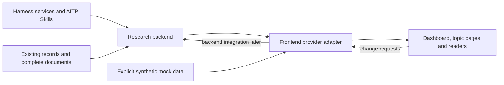
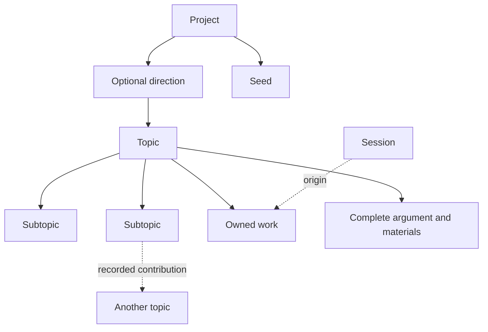
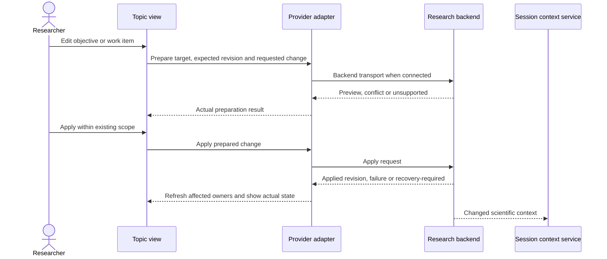

# 16. Topic-centred research environment: assessment and redesign proposal

**Status: revised frontend/interface proposal, 2026-10-23.** The researcher requires a clear topic/subtopic overview, clickable detail and convenient operations for humans and AI, and permits improving beyond the existing research-memory format. The latest clarification is that the backend is still being developed: **this task should leave clear connection interfaces for that backend, not implement a competing backend or select its storage format.** The production integrations are not implemented; the linked prototype uses synthetic in-memory data. The researcher authorized publishing this design/prototype/interface package to main; real-note migration and production write services remain outside this task.

This continues Claude's interrupted design task. [10](10-project-workspace.md), [11](11-research-memory.md), [12](12-desktop-interface.md) and [14](14-implementation-blueprint.md) retain the implemented baseline and selected scope; this proposal updates the target interface and records the work needed to connect it. The UI-1 commit `eb0debfb3c` on `claude/aitp-ui-1` remains the implementation reference. Its historical package tests, client typecheck and lint passed; the repository-wide host typecheck did not complete (killed for memory three times).

The [interactive prototype](prototype/topic-workspace/README.md) demonstrates dashboard, subtopic drill-down, detail views and simulated changes. The interface model describes topics, documents and materials without requiring a particular Markdown heading layout. The backend owns how those objects map to existing files, application records or other storage. A private read-only case evaluation informed the scientific boundaries: `research_notes/AITP-agent-design/topic-centred-case-evaluation-2026-10-23.md` in the parent research workspace. §13 retains portable scenarios; they are design walkthroughs, not successful application runs on real notes or revalidation of those scientific results.

Evidence labels follow [10](10-project-workspace.md#design-package-and-evidence): **observed** (inspected code, records or screenshots), **inference** (an architectural judgment), **proposal** (needs approval) and **open** (an undecided question).

## Summary of the recommendation

- **Show topics and subtopics directly.** A project dashboard displays topic cards and immediate child links. A topic opens with its question, qualified answer and decisive gap, followed by clickable child cards. Work, claims, materials and activity have their own detail views.
- **Keep the frontend independent of storage conventions.** UI-facing objects have topic identity, parent links, qualified state and document/material references. The backend resolves their owners and representation. The screen need not reproduce `research.md` headings or require a new database.
- **Reserve a shared provider interface.** Reads, edit requests, acknowledgements, conflicts and change notifications pass through a replaceable adapter. The current demonstration is an explicit in-memory simulator; its controller is not yet wired to the proposed async port. The contract defines where a later backend adapter connects and keeps that integration separate from the page design.
- **Give every displayed value one owner.** Cards read child state from that child; the parent does not maintain a duplicate child summary. UI edits become requests to the provider. A production UI may claim “saved” only after the backend acknowledges its authoritative change.
- **Use one navigation column.** Research shows the topic tree and Conversations shows Sessions in the same sidebar footprint. This contextual switch is a proposed host integration; existing panel entry, cards, breadcrumbs and temporary outline remain a compatible route while it is unavailable.
- **Use one topic view in two placements.** The main column holds overview and detail tabs; the dock shows compact context beside a conversation. Agent actions open scoped drafts in that conversation, not a second chat.
- **Preserve complete arguments and scientific limits.** A short overview leads to the full body, evidence and exact material. Work completion, source availability and scientific qualification are separate dimensions.
- **Connect in stages.** Complete the frontend interaction with mock data and a concrete contract first, align the contract with the backend owner, then replace the mock with a real adapter and validate the same user path. Backend storage, migration and real writing are not parallel tasks here.

## 1. Critical assessment

### 1.1 What the current design and UI-1 get right

Observed in the UI-1 package source; visual judgments and historical test results below are recorded from Claude’s UI-1 work, not rerun production checks:

- The client package source shows that views derive their research content from resource protocols and show "not connected" rather than inventing content; fixture data is labelled on every screen.
- Topic homes quote the question, current answer and decisive gap verbatim with locators, so a conditional answer is never shortened into a headline.
- Sources & memory keeps researcher words, provisional agent notes, source availability and generated summaries visibly distinct.
- The warm palette and serif reading face make long scientific text comfortable in both themes.
- The architecture in 10 and 11 separates scientific records, operational records (Sessions, proposals) and disposable projections, and forbids hash checks, inferred "proves" relations and duplicated summaries. The separation remains useful; restricting every scientific object to a Markdown passage is reconsidered under the latest requirement.

### 1.2 Limitations of the current UI

Observed:

| Problem | Evidence | Consequence |
| --- | --- | --- |
| Two navigation columns | Research panel at 1440 px: Harness sidebar 280 px plus topic navigator 240 px before any content; at 1024 px the navigator collapses to a strip | Equations, papers and code get the narrowest column exactly where they matter |
| Narrow conversation beside the dock | Session with Sources & memory at 1440 px: conversation column about 513 px; at 1024 px about 400 px | Display equations scroll horizontally; a derivation and its source cannot be read side by side |
| Research state is display only | Topic home and Sources & memory offer navigation and "Start work"; no operation changes an objective, route, decision or assumption | The researcher must ask the agent in chat to change anything, so the state and the conversation drift apart |
| Topic and Session are separate worlds | Inside a Session the dock shows Session memory, not the topic's state | The researcher loses the topic view the moment work starts |
| Sessions are not attached to topics | Session origin metadata does not exist; the host list is flat per Workspace | "Sessions on this topic" cannot be filled; old chats are found by searching |
| Shallow tree and weak overview | The navigator lists only topics linked from the root note; branches appear among links and thread pointers | Real topics have subtopics two or three levels deep. Their question, answer, limitation and next action need direct visible entry points |
| Fixture only | No real provider exists | Nothing has been shown to work on real notes |

### 1.3 Research memory supplies meaning, not the screen layout

The existing protocol's [placement table](../../aitp/plugins/aitp/skills/aitp-writing/references/research-note.md#add-move-and-remove-material-without-losing-the-thread) supplies useful meaning: a thread owns its next action; a correction retains what survives; a route change keeps alternatives and reopening conditions; a choice records scope and reason. The interface should preserve those distinctions without making the researcher understand a heading convention or making every button parse Markdown itself.

Observed gaps remain: real notes often lack stable object addresses; hypotheses and conditions live in prose; semantic propagation requires judgment; real research providers and a shared write service are missing. The frontend cannot close those gaps by presenting a clean mock.

The proposed boundary is a provider that returns topic hierarchy, qualified overview, work, document references and explicit source/capability information. A legacy-note adapter may map source passages into this interface; another backend may own structured records. The backend chooses that mapping and exposes ambiguity instead of silently inventing parentage, approval or scientific status. This task specifies the frontend's needs and tests mock interactions. It neither selects a new persistent format nor migrates research files.

An accepted edit response identifies the affected owners and resulting revision; a propagation state can report that related claims still need integration. The frontend displays those facts without pretending that a changed card automatically updated the full scientific argument.

### 1.4 How the composable philosophy fits the architecture

It fits well where composition is executable or documentary:

- Harness/Cordis already is the plugin framework: service definitions, providers and consumers, composed by profiles, with lifetimes and slots. AITP needs no plugin framework of its own.
- Resource protocols already let readers, providers and views be replaced independently.
- AITP Skills compose research procedures; the method library (`aitp-research/methods/<domain>/`) already documents domain conventions, checks and standard sources.
- The topic tree composes questions while preserving ownership: a branch owns its evidence and continuation, a parent holds its implication and limiting condition.

The distinction between interface structure and scientific judgment matters:

1. **Scientific objects are not executable plugins.** A hypothesis needs an address, conditions and support, but no plugin lifecycle. Harness remains the plugin system.
2. **A typed UI object does not select storage.** The provider can project ordinary files or structured records into the same topic interface. The frontend must not maintain a separately editable answer beside the backend's answer. The F4 trial in 11 warns against duplicate authority; it does not require a document-shaped screen.
3. **Scientific composition cannot be type-checked.** Whether methods combine consistently depends on their actual assumptions and derivations. The interface can expose conditions and missing checks; it cannot establish validity from matching fields.

### 1.5 Which concepts are justified

| Assessment | Concepts |
| --- | --- |
| Required by the current brief | Clear topic/subtopic overview; direct detail access; convenient operations; frontend interfaces that the developing backend can connect later |
| Recommended now | A replaceable mock/provider boundary; topic identity and hierarchy in the interface; complete document/material references; shared read/change results; source and capability information |
| Useful with restraint | Compact topic dock; contextual agent drafts; recorded dependencies; view preferences kept separate from scientific content |
| Outside this frontend task | Selecting a new database or file format; implementing persistent services; automatic note migration; a second runtime; certifying inferred scientific relations |

### 1.6 Tensions this design must balance

- **Overview versus full argument.** The first screen answers what the question is, where it stands and where to click next. The argument and evidence remain directly reachable with qualifications preserved.
- **Structure versus prose.** Fields make retrieval and actions reliable; complete documents carry reasoning. The provider translates between the backend's representation and those needs.
- **Autonomy versus authority.** AI can request routine changes within the task's scope; the backend reports actual authority, capability and outcomes. A clean button or model response does not invent permission or a researcher decision.
- **Independent development versus shared state.** Frontend and backend can progress separately against the same contract. Mock success remains explicitly simulated; the production adapter must return actual saved/conflicted/unsupported states.

### 1.7 Risks and mitigations

| Risk | How it would happen | Interface response |
| --- | --- | --- |
| Competing state | UI, AI and backend independently maintain current answers | One provider-owned value; UI submits operations and rereads acknowledged state |
| Shallow overview | Cards show only titles or completion counts | Show each child's question, qualified answer or gap, disposition and direct destination |
| Mock mistaken for production | Simulated edits use “saved” without provenance | Explicit mock origin; production save only after backend acknowledgement |
| Lost scientific conditions | Compact fields discard limitations from the source | Qualified text and full-body links; missing or ambiguous mapping remains visible |
| Backend coupling | Each component parses files or assumes table names | One adapter boundary, backend-neutral IDs/revisions and explicit capabilities |
| Stale context | Open Sessions retain superseded objectives | Change notifications and observed revisions; refresh through the actual context service |
| Scope expansion | Designing controls starts migration or production services | Keep this task to frontend prototype and interfaces; backend integration has its own scope |

### 1.8 What changes relative to the earlier proposal

The screen no longer follows `research.md` chapter order or depends on a Markdown-only object model. Topic and child cards, detail tabs and the contextual tree express the researcher's navigation needs. Their provider interface is structured; its physical storage remains the backend's decision.

The latest clarification also narrows implementation here: prepare the frontend and its adapter contract so the existing backend effort can connect. Do not start a separate native store, importer or database. Existing source-faithful readers, Harness conversations and resource protocols remain reusable; the missing provider capabilities must be explicit.

Scientific dependencies stay recorded relations or labelled suggestions. Agent reasoning stays in the conversation, and method composition still requires scientific assessment. These evidence boundaries are independent of storage and layout.

<a id="principles"></a>
## 2. The three principles as design constraints

These principles are the researcher's request; this section states what each requires of the system and what it rules out. Structuralism is used here as an organizational and epistemological stance: a theory, model or result is understood through its assumptions, relations and conditions of use. It does not claim that every theory reduces to one computational abstraction.

| Principle | Requires | Rules out |
| --- | --- | --- |
| **Everything is composable, and composition preserves structure** | Explicit interfaces for executable capabilities (Harness services, resource protocols, Skills); explicit conditions for scientific methods (assumptions, validity domain, required checks) stated where they are used; composition of methods treated as a claim that needs verification | Combining methods because their inputs and outputs match; a plugin per scientific concept; a new plugin framework |
| **Research is structured knowledge** | Every claim has one primary home, its conditions beside it, its evidence reachable, and its relations to other claims stated where they matter; failed routes and decisions retained with reasons | Treating notes as a document pile or chat logs as the record; inferring "supports" or "contradicts" from proximity; scores of confidence |
| **Research state outlives sessions** | Backend-owned scientific records and complete documents hold the state; Sessions read and request changes through shared interfaces; export and adapters support continuation | State that exists only in a chat, UI store or model context; generated summaries replacing their owners |

A fourth constraint follows from the three: **the interface is a projection, never an independent owner.** Every displayed value resolves to an owner supplied by the backend; every edit identifies that target. “Open details” is the normal action, with source location available when needed.

<a id="layers"></a>
## 3. Four layers and their boundaries



| Layer | Responsibility | Boundary |
| --- | --- | --- |
| Executable capabilities | Harness plugins, providers, model tools and AITP Skills | Reuse the host; no second agent loop |
| Scientific objects | Topic, work, decision, qualified claim and relation | Interface objects preserve meaning; they do not choose physical storage or establish truth |
| Persistent artifacts | Existing notes, future backend records, complete documents, papers, code, data | Backend owns identity resolution, persistence, write coordination and import policy |
| UI projections | Dashboard, child cards, topic tabs, readers and context views | Read through the adapter; submit requests; never become a competing scientific store |

Session records preserve dialogue and actual delivered context. Backend change records preserve operations and outcomes. Neither is evidence that an unchecked claim is correct.

### 3.1 The frontend contract

The proposed [typed workspace contract](prototype/topic-workspace/workspace-contract.ts) is the concrete handoff to the backend. It describes serializable topic hierarchy, qualified state, source references, documents/materials, edit requests and results, change notifications and explicit capability/availability states. It is an interface proposal, not an implemented server API or a selected persistence schema. Its exact declarations own the field names; the descriptions here state their purpose.

The prototype still uses its existing in-memory simulation and closures internally. Exporting the contract does not mean that every prototype interaction already runs through that async port. Connecting a controller/provider adapter to the real transport remains integration work with the backend. Browser checks establish synthetic interaction behavior; they do not establish persistence or protocol compatibility with an unfinished backend.

### 3.2 Reads, actions and notifications

| Capability | Frontend need | Backend responsibility |
| --- | --- | --- |
| Read project / topic | Hierarchy, qualified overview, direct children, work, choices and material references | Resolve actual owners and revisions; preserve uncertainty |
| Read document / material | Full body or located range, source identity and availability | Read actual content, report missing/unsupported sources and omissions |
| Prepare a change | Target, proposed values/text, expected revision and preview | Resolve target, scope and current base; return conflict or unsupported capability when applicable |
| Apply / revert | Explicit acknowledgement or failure plus affected owners | Coordinate writers, persist safely and report the actual result; do not call a queued request saved |
| Observe changes | IDs/revisions and relevant state changes | Notify from backend observations; reconnect requires re-reading because an event stream may be incomplete |
| Start scoped work | Topic/object origin and editable draft | Integrate with Harness Session/context services; opening a topic does not create or send a Session |

Both UI and model-facing tools should ultimately use these semantic operations or adapters to the same owners. AI convenience means targeted reads and predictable changes, with complete arguments available when needed. The current task supplies the interface and mock experience, not that future model-tool integration.

<a id="information-architecture"></a>
## 4. Information architecture

| Interface object | Meaning | Source boundary |
| --- | --- | --- |
| Project | Research workspace attached to a Harness Workspace | Backend maps its root and identity |
| Direction | Optional grouping of related topics | Explicit grouping, not an inferred scientific relation |
| Topic / subtopic | One page shape at every depth, with parent and related-topic links | Backend supplies stable UI identities and recorded hierarchy; ambiguous parentage remains visible |
| Work item / thread | Owned next action, disposition, pending choice or resume condition | No copied child ledger in the parent |
| Route / alternative | Line of attack with reason, surviving results and reopening condition | Approval/adoption must be recorded, not inferred |
| Document / material | Full argument or reference to a note, paper, code, figure or run report | Actual owner and location remain reachable |
| Seed | Idea whose adoption is open | Opening it does not create an agreed topic |
| Session | Harness conversation with topic/object and intent as origin | Operational record outside the scientific tree |



The breadcrumb expresses the selected navigation path; cross-topic contributions remain explicit links. A child card reads the child's own current state. The parent owns its interpretation of that contribution, not a duplicate child answer. Multiple checkouts must not create duplicate topics merely because Harness opens them as different Workspaces. How the backend represents these relationships in files or storage is outside this frontend contract.

<a id="navigation"></a>
## 5. Navigation: alternatives and recommendation

### 5.1 Alternatives

| Layout | Benefit | Limitation or integration cost |
| --- | --- | --- |
| Current UI-1: navigator inside Research plus host sidebar | Reuses current components | Two navigation columns; shallow topic list; little room for scientific content |
| Dashboard, breadcrumbs and temporary outline only | Requires no host navigation change; makes topic state usable immediately | Repeated navigation through a larger tree may need too many actions |
| One sidebar footprint with Research / Conversations switching, plus dashboard | Visible topic structure with no second persistent column; clear entry to chats | Requires a host navigation contribution or small shell extension that UI-1 does not expose today |
| Always show topic tree and Session tree together | Both lists visible | Crowded sidebar and competing hierarchies; deep titles become hard to read |
| Replace the Harness shell | Full layout control | Unnecessary duplication of host navigation, lifecycle and upstream maintenance |

Official documentation checked on 2026-10-23 supplies limited reference patterns: [VS Code navigation](https://code.visualstudio.com/docs/editing/editingevolved) documents Quick Open and breadcrumb sibling menus; [OpenAI projects](https://learn.chatgpt.com/docs/projects) separates projects and chat transcripts. The official [Codex features illustration](https://developers.openai.com/codex/app/features) shows Pinned, Projects and Recents in its sidebar. This is a documentation-based comparison, not a live desktop usability trial. The recommendation below follows this researcher's overview and drill-down needs rather than copying a chat list.

### 5.2 Recommendation: visible topic structure and direct drill-down

- **Project dashboard:** display topics grouped by direction when helpful. Each topic card has a qualified answer or decisive gap, work disposition and direct links to its children. Waiting choices are visible without browsing chat history. Counts describe work or materials, never a percentage of scientific completion.
- **Topic page:** show question, current answer and gap, followed by direct child cards. A card opens that child's full page. The same layout works for a subtopic at any depth; breadcrumbs provide an obvious return to its parent.
- **One sidebar footprint:** a Research / Conversations switch selects the topic tree or the host Session list. Research navigation is visible in research work; conversations remain directly accessible. This is the recommended shell integration and the synthetic prototype demonstrates it. The production host currently offers `sidebar.workspaces` as one slot, not a per-Workspace child-tree slot; this switch requires an explicit host contribution, not an assumption that a plugin can already replace that interior.
- **Compatible first implementation:** dashboard and child cards run in the existing Research panel with its internal navigator removed. If the shell contribution is not yet ready, breadcrumbs, search and the temporary outline provide navigation; a second persistent tree is not introduced as a shortcut.
- **Search and outline:** Ctrl/⌘ K finds topics, work items and materials. The temporary outline gives a larger tree on demand. Pinning it replaces or collapses the host sidebar so that there is still one persistent navigation column; at compact widths it remains an overlay.
- **Session marks:** existing `sidebar.session.row.leading` and `.hover` slots can show topic identity without a shell change. The topic page lists Sessions by recorded origin.
- **Conversation space:** when a dock opens and width is insufficient, collapse the sidebar through `ctx.layout.toggleSidebar()` or show the dock one at a time. Preserve the user's choice when restoring it; do not toggle blindly on every rerender.

The host retains Workspaces, Session lifecycle, tools and settings. The proposed navigation contribution changes the content of one region; it does not introduce a standalone shell or a second agent runtime.

### 5.3 Width budget

Recorded from Claude’s UI-1 screenshots at 1440 px and 1024 px; the recommended values subtract the same measured widths and are inferences, not production measurements. Switching the existing sidebar content keeps one-column geometry; the revised prototype has its own browser evidence in its README.

| Window | UI-1 Research panel content | Recommended Research panel content | UI-1 conversation beside dock | Recommended conversation beside dock (sidebar as rail) |
| --- | --- | --- | --- | --- |
| 1024 px | strip navigator, about 744 px | about 744 px, no strip | about 400 px | about 625 px |
| 1440 px | about 920 px | about 1160 px | about 513 px | about 740 px |

<a id="layout"></a>
## 6. Layout and activities

Four functional areas, placed within Harness's frame:

| Area | Placement |
| --- | --- |
| Research navigation | Project dashboard and child cards; contextual host sidebar, breadcrumbs, search and temporary outline |
| Agent workspace | The Harness conversation in the main column |
| Interactive research context | Topic overview and detail tabs in the main column; compact Topic tab beside a conversation |
| Research resources | Readers in the Research panel's reading region (without a Session) or as dock tabs (beside a conversation) |

**Activities are arrangements, not modes.** Actions open the tabs an activity needs, and each topic remembers its last arrangement (local view state, no scientific content).

| Activity | Main column | Dock |
| --- | --- | --- |
| Review | Topic state, full width | — |
| Theory | Conversation | Topic tab and the derivation note |
| Literature | Conversation | Paper reader and the reading note |
| Coding | Conversation | Code or diff, and the run report or output |
| Writing | Conversation or the note itself | Topic tab and the manuscript or note |

### 6.1 Wireframes

Project dashboard (no Session):

```text
┌ One sidebar ─────┐┌ Physics research ────────────────────────────────────────────────┐
│ Research | Chats ││ Overview                          Search          Outline        │
│ Physics research │├──────────────────────────────────────────────────────────────────┤
│ ▾ Topology       ││ Topics                                   Choices needing you (1) │
│   ▾ Invariants   ││ ┌ Invariants ──────────────────┐ ┌ Lattice fractional gap ──────┐│
│     Zeros        ││ │ Current answer + limitation│ │ Question / unresolved choice││
│     Benchmark    ││ │ Zeros · Benchmark · Solver │ │ Active route · Alternatives ││
│     Solver       ││ │ Open topic →               │ │ Open topic →                ││
│   Fractional gap ││ └────────────────────────────┘ └───────────────────────────────┘│
│ ▾ Methods        ││ Seeds and connections                                           │
└──────────────────┘└──────────────────────────────────────────────────────────────────┘
```

Topic overview and direct children:

```text
┌ One sidebar ┐┌ Physics › Topology › Invariants                        Start session ┐
│ Topic tree  ││ Overview | Work & choices | Claims & routes | Materials | Activity  │
│             │├──────────────────────────────────────────────────────────────────────┤
│             ││ Question: …                    Edit                                │
│             ││ Current answer: … under the stated conditions …                    │
│             ││ Decisive gap: …                                                     │
│             │├ Subtopics ──────────────────────────────────────────────────────────┤
│             ││ ┌ Zeros ──────────────┐ ┌ Benchmark ───────────┐ ┌ Solver ─────────┐│
│             ││ │ Question           │ │ Question             │ │ Question       ││
│             ││ │ Answer + limitation│ │ No accepted result   │ │ Limited control││
│             ││ │ Next / waiting for │ │ Pending choice       │ │ Next action    ││
│             ││ │ Materials · Open → │ │ Materials · Open →    │ │ Open →         ││
│             ││ └────────────────────┘ └──────────────────────┘ └──────────────────┘│
│             ││ Needs attention · linked argument · recent work                    │
└─────────────┘└──────────────────────────────────────────────────────────────────────┘
```

Opening Zeros shows its own overview, work, claims and materials with a breadcrumb back to Invariants. A material opens its reader at the referenced passage. Starting a Session opens the existing conversation with that topic as origin and the compact Topic tab beside it. No navigation action silently sends a prompt.

```text
┌rail┐┌ Conversation: Zeros · Invariants ─────────────────────┐┌ Topic | Derivation ──┐
│ ◉  ││ Research context read for this request                ││ Question and answer │
│ ◎  ││ Agent reasoning and equations                         ││ Changes since read  │
│    ││                                                       ││ Work / sources      │
│    ││ [ Message…                                      ] ↑   ││ Open full topic →   │
└────┘└───────────────────────────────────────────────────────┘└─────────────────────┘
```

<a id="topic-state"></a>
## 7. The topic state view

The topic view reads one topic and its immediate children from the workspace service. It works for a topic or subtopic without assuming a Markdown chapter order. The main column provides overview and detail tabs; the compact dock shows the same authoritative fields with fewer controls.

### 7.1 Overview and detail tabs

| View | Content | Default visibility |
| --- | --- | --- |
| Header | Title, breadcrumb and topic action; source/revision details available on demand | Always |
| Overview | Question and scope, qualified current answer, decisive gap, direct child cards, relevant attention items and argument links | Initial view |
| Work & choices | Owned next actions, dispositions, pending choices, retained instructions and proposals awaiting review | One tab away; non-empty attention count visible |
| Claims & routes | Assumptions, hypotheses, qualified results, alternatives and recorded dependencies | One tab away; unclassified prose remains in the document |
| Materials | Documents, derivations, papers, figures, code and run reports with availability and precise destinations | One tab away; relevant links also appear on cards |
| Activity | Recorded changes and Sessions, with applied/proposed/conflicted state and provenance | One tab away |

A child card reads the child's question, answer or gap, current work disposition and next action directly from its owner. It opens the child page and provides relevant material links. A missing answer is shown as “no recorded answer”; a successful control does not turn a whole topic green. Parent-level scientific interpretation remains a separate, explicitly owned statement.

### 7.2 Cards and detail readers

Topic and child cards are distinct clickable groups with enough space to scan question, current state and next destination. Work items and materials use compact rows where comparison is easier. Selecting a card opens a page or exact material, not a tooltip containing the only useful information. Menus expose secondary operations; key actions such as opening a child, editing an objective and starting a Session remain visible.

A detail page retains the full wording, qualification, support and ownership of the selected object. Scientific labels describe origin and evidence at their actual strength; work dispositions describe what is happening. These dimensions are not collapsed into one status chip. The normal entry is “Open details” or “Open material”; “View source” provides its backend-supplied owner and locator, and generated Markdown is labelled as a preview/export.

<a id="direct-operations"></a>
### 7.3 Direct operations

Every edit produces a change request ([§10.3](#change-record)) at the named record field or body passage. Consequential edits show a preview; routine changes can apply with Undo within the existing write scope. Propagation is a task for the agent's memory cycle, visible as waiting on integration until assessed. These are target interactions; actual availability follows the backend capability and authorized write scope. No real source is written by this prototype.

| Scenario | UI operation | Local edit at the owner | Propagation task | Confirmation |
| --- | --- | --- | --- | --- |
| A. Change the objective | Edit scope on the overview | Topic scope field and a choice with date, scope, researcher and reason | Threads now outside scope, parent's using passage, root implication | Diff preview, one Apply |
| B. Correct an interpretation | Select the passage, choose "Correct", write the correction | The primary account, with what survives and why the earlier inference fails | Maintained uses of the corrected claim; a correction note where readers met the error | Diff preview, one Apply |
| C. Reject a hypothesis | On a hypothesis card: "Mark unsupported" or "Decline" with a reason | Record "unsupported" or "declined by the researcher" with the reason and retained alternative; "refuted" requires a counterargument or failed check, not a preference | Claims that used it; agent working items that assumed it are retired | Diff preview, one Apply |
| D. Change a route | On a work item or alternative: "Supersede by…" | Retain the former route with what survives and its reopening condition; create/select the new work item and record the choice | Opening, parent pointer, plans linked from the old thread | Diff preview, one Apply |
| E. Invalidate an assumption | On an assumption: "Flag as invalid" | Assumption label and a short reason | Dependents: recorded ones listed exactly, suggested ones listed as candidates ([§12.4](#impact)); each affected claim gets a qualification naming the assumption until re-evaluated | Diff preview, one Apply; dependents reviewed one by one |
| F. Update evidence | On a thread or result: "Record result", link the report | Replaces the comparison value at its substantive location with conditions | Opening and conclusion if the answer changed; parent if the contribution changed | Diff preview, one Apply |
| Routine | Change a disposition, next action or date; pause or resume a work item; fix a link | The owning work item or reference | None, or the parent pointer if the contribution changed | None; Undo for 10 s and Revert later |

### 7.4 Contextual agent actions

Object menus offer: Explain, Challenge assumptions, Derive, Find literature, Compare with another route, Verify, Update dependent notes, Start an investigation. **All of them open in the conversation**: the current topic Session if one is shown, otherwise a new Session whose origin is the object, with a draft that names the object's locator and the intended operation. The researcher can edit the draft before sending. The topic state stays visible beside the conversation in the dock.

| Action | Draft carries | May the agent write? |
| --- | --- | --- |
| Explain, Find literature, Compare | Object passage, its conditions, linked sources | No, unless the researcher asks |
| Challenge assumptions, Verify | Object, recorded dependencies, earlier failed routes, the verification Skill | Records its check; changes claims only as proposals |
| Derive, Start an investigation | Object, scope, applicable decisions | Within the task's write scope; consequential changes as proposals |
| Update dependent notes | The change record and its dependents | Applies placement edits within the write scope; the researcher reviews them in Recent changes |

Proposals the agent produces appear in the topic state's Needs you section as diffs with Accept, Edit and Decline; accepting applies them through the same write path.

<a id="sessions"></a>
## 8. Topic-aware sessions

- **Starting.** "New session" on a topic, thread, statement or resource records the origin (workspace and topic ID, optional object/document locator, intent, observed revision) in Harness Session metadata. Legacy origins retain path and passage locators. This needs a backend addition (Session origin metadata is missing today).
- **Context for a new Session** follows 10's [intent recipes](10-project-workspace.md#work-session-and-context-architecture) and adds the topic's applied changes since the Session's origin was last read: researcher corrections, binding choices and retired agent items. It does not load earlier chats; it can link them as provenance.
- **Continuing.** Opening an earlier Session shows its origin, and, if the topic changed since its last request, a notice listing the changes; the next request receives them ([§10.7](#active-sessions)).
- **Finding Sessions.** The topic state lists Sessions by origin; host sidebar rows carry the topic mark and a hover card with topic, thread and task.
- **Ending.** Closing a Session changes no scientific record. Outcomes that were integrated appear in Recent changes; outcomes that were not stay as proposals.

<a id="resources"></a>
## 9. Research resources

| Resource | Available now | Next | Depends on |
| --- | --- | --- | --- |
| Documents with mathematics | UI-1 Markdown reader (panel and dock), fixture only | Backend body/note providers, precise locators, outline, copy as LaTeX | Workspace/document provider with Session-independent read authority |
| PDF papers | Harness document preview (generic) | Edition-aware reader with page and selection locators | Literature provider (P2b) |
| Code and Git | Harness file preview and LSP | Checkout-aware code and diff view linked to formulas | Checkout provider (P2c) |
| Logs, figures, numerical outputs | Generic preview | Run report view linking inputs, outputs and the question tested | Run/report conventions in the notes |
| Knowledge entries | — | Wiki reader with prerequisites | Knowledge provider (P2a) |
| WSL research files from Windows | Harness Electron carrier | Explicit host and root mapping | Real-host checks (P2d) |

Material readers resolve the actual owned body or external artifact. Generated Markdown is an explicitly labelled export preview; it never masquerades as the independently editable current source.

<a id="synchronization"></a>
## 10. State synchronization interface

### 10.1 The loop



The current prototype simulates this interaction locally; it does not call a real backend. The serializable contract leaves a clear place for that transport and controller integration. UI and AI changes must ultimately reach the same scientific owner, rather than separate chat and form writers.

### 10.2 Authority

The backend owns the persistent representation and mapping from interface targets to files or records. The UI owns selection, open tabs and unsubmitted drafts. An optimistic draft is visibly pending and cannot be reported as saved until an applied response arrives. Generated Markdown previews are labelled projections of the mock; they do not assert a real source file or prescribe future storage.

<a id="change-record"></a>
### 10.3 Change information at the interface

A request needs an identity, target, expected source revision, operation, exact actor request and proposed field/text change. A preparation returns a preview or a specific inability to prepare. Application distinguishes applied, conflicted, failed, unsupported and recovery-required outcomes, with affected owner identities and revisions where available. Actual field names and operation coverage belong in the [typed contract](prototype/topic-workspace/workspace-contract.ts); unsupported operations remain explicit rather than silently falling back to direct file writes.

Revision tokens are opaque to the frontend and introduce no hash checks. The backend decides how they are assigned and compared. Change provenance distinguishes researcher words, agent proposals and observed external changes; an unknown external actor remains unknown.

<a id="operation-catalogue"></a>
### 10.4 Operations the view needs

| Interaction | Target and result needed |
| --- | --- |
| Edit objective or qualified answer | Topic field, exact proposed text, preview, applied owner or conflict |
| Update next action/disposition | Owned work item, current base and acknowledged result |
| Correct a claim or body passage | Located owner with conditions retained; no vague global replacement |
| Record a choice or retained alternative | Scope, reason, source actor and surviving result |
| Link material | Actual reference and availability; link alone is not support |
| Review/revert change | Change identity, affected target and current-base comparison |
| Start contextual agent work | Topic/object identity and editable scoped draft |

Topic creation, reparenting, import, export and other organizational operations can be added through the same adapter as the backend supports them. Controls must not imply that an operation already exists. The initial contract need not claim every proposed action in this document.

### 10.5 Persistence and recovery belong to the backend

The backend must define write scope, target resolution, writer coordination, durable acknowledgement and recovery before enabling real application. A frontend revision check cannot prevent a racing external editor, and a file rename alone cannot guarantee no lost update. Multi-owner edits need actual partial-completion and recovery reporting; the UI must not invent cross-file atomicity. These remain backend requirements to agree at connection time, not a storage implementation delivered here.

<a id="concurrency"></a>
### 10.6 Conflict and reconnection

The view displays base/current/proposed content when the backend reports a conflict. Choosing a resolution creates a fresh request against the current base; it does not overwrite silently. If the provider is disconnected or unsupported before submission, keep the unsent draft. If the connection fails after submission and no receipt arrives, show an unknown outcome: the backend may already have applied the change. Retain the operation ID for reconciliation or an identical retry under the backend's idempotency contract; do not label it unsaved or issue a fresh operation blindly. Change notifications invalidate affected views; after reconnect the UI rereads them, because missed notifications cannot be assumed complete.

<a id="active-sessions"></a>
### 10.7 Session context

A new Session needs topic state, relevant work/choices and the full documents required by the task, with explicit omissions. An active Session can display stale context after its delivered sources change. Actually delivering refreshed, logged context is the backend/Session integration's job; a frontend badge alone cannot claim the model received it. Already dispatched work is not silently cancelled. Subsequent dependent actions must respect the current user agreement and actual task scope.

### 10.8 Provenance

Display source locators, actor attribution and change state as supplied by the provider. Never relabel a simulated operation, generated summary or agent interpretation as a real saved decision. Scientific origin, verification scope and researcher authority remain distinct.

### 10.9 Review and revert

Activity distinguishes proposals, applied changes and conflicts. Revert is a provider operation checked against current state, not replacement of an entire topic with an old UI snapshot. If no backend capability exists, the real UI cannot offer a functioning Revert; the prototype's simulated version is labelled as such.

### 10.10 Semantic integration

An acknowledged local edit may still leave related arguments awaiting integration. The provider can return that state and affected owners. A routine field update does not automatically trigger a fixed scientific workflow. When consequential claims change, the existing AITP verification and memory processes retain their qualifications, source coverage and authorized scope.

### 10.11 One displayed value, one source

Child cards, detail pages and eventual AI context read the same provider-owned value. The parent does not keep a copied child answer or next action. The UI may cache observations and retain drafts, but rereads acknowledged owners after an edit. If the backend cannot map a passage reliably, the interface exposes that uncertainty rather than silently filling a polished summary.

<a id="failures"></a>
### 10.12 Failure states to preserve

| State | Frontend behavior |
| --- | --- |
| Mock | Clearly simulated; changes last only in the demonstration's current state |
| Not connected / unsupported | Explain unavailable capability; retain readable existing content and unsent draft |
| Missing source / failed read | Distinguish absence from read failure; preserve exact destination |
| Pending | Do not claim saved or integrated |
| Conflict | Show current base and requested change; require a freshly prepared resolution |
| Applied | Refresh returned owners/revisions; show only the acknowledged effect |
| Partial / recovery-required | Retain the reported state and affected owners; no automatic blind retry |
| Stale context | Show that current UI state and delivered Session context differ until actual refresh |

<a id="epistemic-status"></a>
## 11. Epistemic status and approval boundaries

### 11.1 Status vocabulary

The UI preserves the recorded meaning and qualification. Interface objects may carry an explicit kind and verification references; source prose is not silently classified by a parser. Markdown exports can render these labels readably:

| Kind | Possible readable rendering | Meaning |
| --- | --- | --- |
| Literature result (imported) | `**Result (imported).**` with the source | Attributed to literature under stated conditions; import alone does not establish source correctness |
| Derived here | `**Result (derived here).**` with the derivation link | Derived in this research; checks named by verification records |
| Numerical evidence | `**Evidence.**` with the report link | Observations under stated settings; not a convergence or validity claim by itself |
| Hypothesis or conjecture | `**Hypothesis.**` / `**Conjecture.**` | Motivated, unproved; what would test it |
| Assumption | `**Assumption.**` | Taken as given for the argument; may be flagged invalid |
| Speculation or idea | A seed | Uncommitted |
| Known failure | A retained alternative with its kind | Failed under stated conditions |
| Open question | `**Open question.**` or account prose | Unresolved; not a task by itself |

Kind and verification are separate: imported/derived/numerical describes origin; unchecked, source-checked, re-derived or consistency-checked describes a named check and scope. A researcher decision records authority over the route, not proof of a scientific statement. Unlabelled prose remains "not classified". The UI never assigns confidence from fluency, recency or a passing test.

### 11.2 Who may change what

| Actor and change | Effect | Approval |
| --- | --- | --- |
| Researcher: routine thread fields, links, wording | Applied | None; Undo and Revert |
| Researcher: objective, decision, route, label, correction | Applied with propagation task | One-step diff preview |
| Agent: routine placement within an authorized write scope | Applied; listed as an agent change | None; reviewable and revertible |
| Agent: new or changed consequential claim, promotion of a label, route or objective change, retiring a researcher item | Proposal in Needs you | Researcher accepts, edits or declines |
| Agent: verification record | Recorded with checks done and not done | None; changes no label by itself |
| External editor | Detected observation; projections refresh and coordinated-write limits apply | No automatic overwrite, import or actor attribution |

An agent cannot invent a researcher decision or silently promote a claim. It can accurately record an explicit researcher choice already given. The proposed consequential-edit review default does not revoke an existing, explicitly delegated write scope or require repeated approval of routine work; D4 covers alignment with the backend owner, including actual capabilities and authoring scope before connection. A provider must deliver the real user decisions rather than treating a format-specific instruction as broader authority.

<a id="relationships"></a>
## 12. Scientific relationships, dependencies and method contracts

### 12.1 What already exists

11 defines a relation vocabulary (`links-to`, `contains`, `contributes-to`, `uses`, `cites`, `implements`, `tests`, `supersedes`) and forbids inferring “contradicts”, “proves” or “validates” from ordinary links. The protocol calls for a bounded search of dependent claims after a consequential change. Those meanings survive a change of representation.

<a id="statements"></a>
### 12.2 Addressable statements when an operation needs them

The interface needs topic identity and parent links for navigation. A more precise claim target is useful when the researcher corrects, cites or qualifies a particular statement. The backend supplies that target's full qualified text or authoritative body locator, kind, conditions and recorded support. It can map this to ordinary prose or another representation; the frontend does not require a separate claim database.

For example, a grid-resolution assumption and a numerical observation may be linked with the explicit condition that a refinement check remains required. The display must retain that limitation rather than styling sampled agreement as a continuum result. This is a fixture requirement, not a checked calculation. Likewise, a topological Hamiltonian definition, an invariant reduction and a physical response remain different claims.

Unclassified paragraphs remain readable in full. A provider unable to resolve a claim precisely returns that limitation. The backend's future mapping and model tools need no mandatory new Markdown syntax solely to satisfy this screen.

### 12.3 Recorded versus inferred dependencies

- **Recorded:** an explicit backend relation with its owner and reason, or an unambiguous relation clause in a source. A plain link records navigation only; it is not automatically an assumption or support relation. The UI shows the recorded meaning and uses relevant relations for impact lists.
- **Suggested:** found by the agent or a text search (terminology, aliases, incoming links without clauses). The UI shows it as "suggested, not recorded" with the reason. A suggestion becomes recorded only through an applied edit.

<a id="impact"></a>
### 12.4 Impact of an invalidated assumption

1. Collect recorded dependents (explicit assumption/use relations supplied by the backend), across the authorized workspace, with cycle detection and a reported traversal budget. A truncated search displays its unvisited frontier; depth three is a possible UI expansion default, not scientific completeness.
2. Collect suggested candidates by bounded search, labelled as such.
3. Show both lists with the complete relevant claim; for each recorded dependent, the propagation task adds a qualification at its authoritative owner naming the invalid assumption ("conditional on … , now flagged invalid") until the claim is re-evaluated.
4. The researcher or agent re-evaluates each dependent: still holds under other support, needs a new argument, or fails. Each outcome is an ordinary change.

Nothing is deleted, and the search is reported with its coverage; it does not claim to find every semantic dependency.

### 12.5 Scientific module contracts live in method notes

A reusable method (a GW variant, a topological invariant formula, a composite-fermion mapping) is documented where AITP already keeps methods, `aitp-research/methods/<domain>/` or a topic's `skills/`, with these optional sections: inputs and outputs; definitions and conventions; assumptions; validity domain; dependencies; approximations; verification required before use; known limitations. Composing two methods is then a claim: the note that combines them states which conditions of each it relies on, and verification checks them. Illustrations of what such a composition must check:

- *GW with a Green-function topological invariant:* which Green function enters (quasiparticle, self-consistent, full); analyticity and frequency dependence; zeros of $G$; gauge invariance; whether vertex corrections or Ward identities change the invariant.
- *GW with DMFT:* the double-counting choice and the separation of local and non-local self-energy.
- *Composite fermions with numerics:* the explicit map between effective and microscopic degrees of freedom, and which observables survive the map.

This is documentation plus verification, not an executable module system. An executable check (for example, a numerical sum rule) is an ordinary test linked from the note.

### 12.6 Compatibility at the adapter

Existing notes need no conversion to review this frontend. The backend owner decides how existing files map to topic identities, text and relationships, and whether future import/export operations are needed. The contract must preserve source locators, unsupported capabilities, ambiguous structure and actual revisions. It must not hide missing mapping behind a convincing synthetic object.

Portable AITP Skills and model tools need to read and change the same owners as the UI. That is a later integration check with the backend, not proof supplied by a TypeScript declaration. This task neither edits upstream Skills nor chooses a new storage format.

<a id="cases"></a>
## 13. Case walkthroughs

The three case types below correspond to the researcher's projects; the case evaluation applies them to the actual records. Here they are described by structure only.

### 13.1 Theory, implementation and benchmark (Green-function topology with many-body methods)

Structure: a parent topic with several branches (theory, implementation, benchmarks), decisions selecting one method and deferring another, paused production runs.

1. Open the project home; the direction shows the topic with live and waiting counts.
2. Open the topic; child cards expose theory, implementation and benchmark branches with their own limits; the overview surfaces the relevant pending choice.
3. Review the opening: retain the distinction between implementation closure, numerical control, invariant reduction and physical response.
4. Open a child card, then its derivation in the reader; open the linked code checkout from Materials and return through the breadcrumb.
5. Start a Session from the applicability thread; the draft names the question, assumptions and the numerical work actually authorized.
6. On the assumption card choose "Challenge assumptions"; the conversation receives the assumption and its recorded dependents.
7. The researcher corrects an overstatement equating a computed invariant with a measured response; the agent proposes a located qualification without claiming to have solved the missing response problem.
8. The change edits the authoritative claim or body passage; propagation qualifies the parent’s using statement while preserving any useful implementation result.
9. Verification records which steps were re-derived and which are only consistent.
10. A new Session on the benchmark thread starts with the qualification already in its context.

Failure checks: the implementation branch changes in a coordinated Codex session meanwhile (revision checked, a new preview prepared if disjoint); the paused run's resume condition survives; verification of the numerical check fails and remains beside the claim.

### 13.2 Competing routes (fractional Chern insulators and composite fermions)

Structure: one active theoretical question, several candidate constructions retained as alternatives, a deferred model comparison waiting on a researcher choice.

- Open the project → topic → Work & choices → linked derivation/method note; start a new Session from the active theoretical thread. Review its explicit unresolved choices before discussing a route.
- The Routes section lists the candidate constructions as hypotheses with "alternative, not adopted" status; none is shown as the answer.
- Choosing a route records a binding choice and turns the others into retained alternatives with reopening conditions; nothing is deleted.
- A reusable mapping (effective to microscopic degrees of freedom) is linked as a method note whose validity domain is visible when another topic uses it.

After an explicit choice, preview the owner edit, retain the other constructions and their conditions, inspect the diff and linked evidence, then open a fresh Session and check recovery from persistent workspace records and body documents without chat history. This proposed ten-step route is not a production test.

Failure checks: an agent session restates one construction as "the" approach (the change is a proposal and cannot relabel the hypothesis); the researcher rejects a hypothesis, and a later Session's context carries the rejection and its reason.

### 13.3 Exploratory formulation (a quantum-gravity seed)

Structure: a seed with an assessment note and no topic note yet; the formulation itself is open.

- The project home shows the seed with its provenance as the root note states it (for example, proposed by the researcher and assessed, but not yet an agreed topic).
- Open the root’s seed entry, inspect its assessment note and the source’s uncertainty labels, then start a context-aware Session. There is no invented topic state to review.
- A Session can start from the seed with intent "explore"; it creates no topic or thread.
- Promotion is an explicit operation retaining the seed origin. The backend defines its target and write capability; the prototype does not create a real topic, folder or document when a seed is opened.
- Tentative ideas stay labelled as hypotheses or open questions; the topic state shows "no established result" rather than an empty answer field styled as complete.

A correction during exploration targets the seed’s existing assessment, with a preview and a qualified verification record. A later Session rereads that assessment and the seed owner; it must recover both the correction and “not yet an agreed topic”. No folder is created by this ten-step design walkthrough.

Failure checks: the agent writes a speculative claim as a result (blocked: promotion needs the researcher); the seed is discussed in two Sessions (both read the same seed; neither creates a topic).

<a id="visual-system"></a>
## 14. Visual and interaction system

This extends [12's visual system](12-desktop-interface.md#visual-system) and the implemented AITP palette.

- **Density.** Use distinct topic/subtopic cards for overview, compact rows for work and materials, and full reading text for arguments. Aim for 14 px UI text, 16–17 px reading text and secondary metadata that remains legible. Cards expose meaningful state, not just decorative counts.
- **Hierarchy.** The title, question, qualified answer and gap lead the overview. Child cards are the next major group. Detail tabs keep work, claims, materials and activity easy to find without stacking every section into one long page.
- **Status.** Text first, colour second: "waiting on you" (warning), "agent proposal" (violet, dashed), "declined" (muted, struck title), "invalid assumption" (error), "not classified" (neutral).
- **Equations.** KaTeX display equations scroll inside their own box; target at least 620 CSS px for conversation when space permits; otherwise the dock becomes an overlay or one-at-a-time view. The guarantee is available reading width, not an impossible fixed multi-column layout at every zoom.
- **Long content.** Titles wrap to two lines then ellipsize in lists; full titles appear in the header; passages expand in place.
- **Keyboard.** Ctrl/⌘ K palette; Ctrl/⌘ Shift O outline; Alt ←/→ back and forward; `E` edit the focused card; `.` open its menu; Enter open in note; Ctrl/⌘ Enter apply a previewed change; Escape cancel; focus returns to the originating card after every dialog.
- **Menus and dialogs.** Keep primary drill-down and editing actions visible; menus hold secondary operations. Consequential changes show a clear before/after preview. The reader can offer a scoped action on selected text without creating another conversation surface.
- **States.** Not connected, loading (one centred indicator), empty with the reason, failed with retained content, conflict, stale.
- **Resizing.** The dock and main column use Harness's resize handles; the topic state reflows to one column below 760 px container width.
- **Accessibility.** All status is in text; diff previews have accessible before/after labels; contrast at least 4.5:1 for text.

<a id="blueprint"></a>
## 15. Implementation blueprint

[14](14-implementation-blueprint.md#topic-redesign-review) owns the actual development sequence. The latest request makes this a frontend and interface handoff to the existing backend effort; no parallel backend implementation starts here.

### Phase 0: frontend interaction and concrete interface

Deliver the project dashboard, direct child cards, topic detail tabs, material destinations and editing feedback with labelled synthetic data. Retain a serializable typed contract for project/topic/document reads, preparation/application results and change notifications. The current simulator may retain scenario closures; completing this phase does not mean it implements the proposed async provider. Browser checks cover the visible paths and failure simulations.

### Phase 1: adapter and controller integration

Align the contract with the backend owner: IDs, revisions, capabilities, missing-source states, change results, notification/reconnect behavior and Session origins. Connect the frontend controller through the adapter to a mock implementation of those agreed ports, then to the real backend transport. Keep view code independent of Markdown parsing, database tables and filesystem paths. Test disconnected, loading, stale, conflict and unsupported states as well as successful reads.

### Phase 2: real read path and host navigation

Demonstrate dashboard → subtopic → actual document/material → parent return with source fidelity. Add the contextual Research / Conversations sidebar through a supported host contribution; existing Session row slots alone cannot supply it. The existing Research panel, breadcrumbs and outline provide a compatible path while that integration is pending. Validate source availability, deep titles, equations, keyboard/focus, themes and compact widths.

### Phase 3: real edit and Session context connection

Enable only the operations and write scope the backend actually supports. Acknowledged changes refresh the same owner in cards, detail pages and a fresh Session. Validate stale revisions, conflicts, actual persistence/restart, revert, partial failure and model-visible context delivery. Those are backend/application acceptance checks; simulated prototype edits do not count. The backend owns recovery and any import/export policy.

### Phase 4: broader resources and dependencies

Connect edition-aware papers, checkout-aware code/diffs, run reports and bounded recorded dependencies as their providers become ready. Preserve exact destinations and coverage limits. A topic's navigation structure is already needed in Phase 0; richer relation analysis is not a prerequisite for a useful overview.

<a id="gates"></a>
## 16. Review and verification gates

The checks apply to the changed frontend or integration slice, not to every scientific action:

1. **Interaction:** dashboard → child → detail/material → parent; editing feedback; context navigation; keyboard and narrow layout. Report mock behavior separately from real application behavior.
2. **Contract:** type-check the declarations, ensure serializable requests/results, and state which operations are proposed, implemented or unsupported. Declaration checks do not prove a server implements them.
3. **Source fidelity:** on later real connection, preserve conditions, decisions, failures and exact material destinations. Child cards and pages read one owner.
4. **Actual save and context:** only backend acknowledgement establishes application; persistence/restart and model-visible refresh require their own integration evidence.
5. **Layout:** both themes, long titles/equations and varied widths; actual 200 % zoom is distinct from a narrower viewport simulation.
6. **Regression:** preserve Harness Workspace/Session behavior and supported UI-1 reading paths while replacing selected contributions.

The existing repository-wide host typecheck remains unverified where memory limits prevented completion. Prototype browser checks and standalone interface type checks do not replace it. No new hash checks, real-note writes, persistence guarantees or scientific acceptance are established here.

<a id="decisions"></a>
## 17. Agreed direction and connection choices

The researcher has already established the goal and this task's boundary: a clear, convenient topic/subtopic interface, freedom from the existing memory format, and reserved interfaces for the developing backend. Do not ask for those choices again. Production integration and storage changes are outside this frontend prototype task. Publication of this design package is now authorized.

| | Choice | Current treatment |
| --- | --- | --- |
| D1 | Navigation | Dashboard, child drill-down and breadcrumbs; contextual Research / Conversations sidebar is a proposed host contribution |
| D2 | Topic organization | Overview, Work & choices, Claims & routes, Materials and Activity; compact Topic view beside conversation |
| D3 | Frontend/backend boundary | Concrete typed semantic contract; no selection of persistent files, tables or database |
| D4 | Backend connection | Align IDs, revisions, capabilities, actual write scope and transport with the backend owner; no new approval request for a storage scheme this task does not choose |
| D5 | Scientific structure | Preserve qualified claims, conditions and exact support; backend maps their representation and availability |
| D6 | Agent interaction | Scoped drafts in the existing conversation; later model-tool integration must reach the same owners |
| D7 | Recovery/history | Backend supplies actual results and recovery state; frontend displays them without inventing atomicity or persistence |
| D8 | Width | One persistent navigation column, rail/overlay as needed; preserve reading space |
| D9 | Session origins | Reserve topic/object identity and observed revision; actual persistence and context delivery need backend integration |
| D10 | Publication | Publish this design/prototype/interface package to main as authorized; keep separate UI-1 implementation commits out of this publication |

<a id="changes-on-approval"></a>
## 18. Existing owners and handoff

- **10:** shared frontend/provider boundary and actual Harness responsibilities; do not select backend storage through a UI design edit.
- **11:** preserve scientific ownership, full text and source fidelity while allowing backend mapping beyond one Markdown layout.
- **12:** topic overview, direct child drill-down, detail tabs and contextual navigation; distinguish synthetic controls from connected application behavior.
- **13:** topic → child → material → change feedback as the user path, with scientific limitations and mock/real evidence kept separate.
- **14:** frontend/interface completion and later backend connection remain in the single development sequence. The proposed phases here are dependencies, not a parallel progress ledger.
